# SelfHeal — Intelligent Self-Healing UI Automation Framework

<div align="center">

[](https://www.python.org/)
[](LICENSE)
[](tests/)
[](docs/experimental_evaluation.md)
[](docs/experimental_evaluation.md)
[](docs/experimental_evaluation.md)
[](docs/architecture_diagrams.md)

**A production-grade, deterministic self-healing test automation framework for Microsoft Playwright in Python.**  
*Autonomously recovers broken DOM locators caused by routine UI refactoring without brittle monkey-patching, unbounded retries, or non-deterministic LLM hallucinations.*

---

**Moon Sanctum Labs** — *Decode. Build. Evolve.*  
**Lead Full-Stack Engineer & Architect:** [Aniket Nandi](https://github.com/) (Kolkata, IST)

</div>

---

## 📌 Table of Contents

- [The Problem: The Flaky Test Maintenance Tax](#-the-problem-the-flaky-test-maintenance-tax)
- [The SelfHeal Solution: Deterministic Intelligence](#-the-selfheal-solution-deterministic-intelligence)
- [Key Features](#-key-features)
- [System Architecture](#-system-architecture)
- [Deterministic Healing Workflow](#-deterministic-healing-workflow)
- [Multi-Dimensional Similarity Engine](#-multi-dimensional-similarity-engine)
- [Empirical Benchmarks (109 Scenarios)](#-empirical-benchmarks-109-scenarios)
- [Streamlit Engineering Audit Dashboard](#-streamlit-engineering-audit-dashboard)
- [E-Commerce Demonstration & Live Viva Runner](#-e-commerce-demonstration--live-viva-runner)
- [Installation & Quickstart](#-installation--quickstart)
- [Configuration](#-configuration)
- [Command Line Interface (CLI)](#-command-line-interface-cli)
- [Documentation Index](#-documentation-index)
- [Security & Privacy](#-security--privacy)
- [Contributing](#-contributing)
- [License](#-license)

---

## 🛑 The Problem: The Flaky Test Maintenance Tax

In modern agile and continuous-deployment environments, **automated UI tests break constantly**. Studies show test automation teams spend **30% to 40% of their engineering capacity** simply diagnosing and updating selectors broken by benign frontend refactorings:
- Kebab-case IDs renamed to camelCase (`#btn-submit` $\rightarrow$ `#btnSubmit`).
- Modern CSS utility classes replacing semantic styling (`.primary-button` $\rightarrow$ `.bg-blue-600 .hover:bg-blue-700`).
- Text copy tweaks (`"Log In"` $\rightarrow$ `"Sign In"` or `"Continue to Payment"` $\rightarrow$ `"Proceed to Payment"`).
- Restructured DOM wrappers (wrapping buttons in new responsive `<div class="flex flex-col">` containers).

### Why LLM-Based Healing Fails in Real CI/CD Pipelines
Recent attempts to address this with Generative AI / Large Language Models introduce fatal operational flaws:
1. **High Latency**: Cloud LLM round-trips take 2 to 8 seconds per failure, destroying CI pipeline performance.
2. **Hallucinations & Non-Determinism**: An LLM cannot guarantee reproducible results; the same test run on the same commit may pass or fail randomly.
3. **Catastrophic False Positives**: Generative models guess when uncertain. In automated testing, **clicking the wrong button is catastrophic** (e.g. clicking "Delete Account" or "Submit Order" prematurely).
4. **Data Privacy & Cost**: Sending internal DOM snapshots and sensitive form structures to cloud APIs violates enterprise security and costs hundreds of dollars in token usage.

---

## 💡 The SelfHeal Solution: Deterministic Intelligence

**SelfHeal** replaces probabilistic hallucinations with **rigorous, deterministic mathematics**:
* **Purely Local & Sub-Millisecond**: Computes multi-dimensional similarity locally in $\approx 3.2\text{ ms}$ per candidate using `RapidFuzz` and set theory. Zero cloud calls.
* **Strict "Zero False Positive" Policy**: Enforces a confidence threshold ($S \ge 0.80$) and an **ambiguity margin** ($\Delta \ge 0.10$). If two candidates are too close in score, SelfHeal safely abstains rather than making an unverified guess.
* **Failure Classifier Gatekeeper**: Distinguishes true locator absence (`count == 0`) from actionability defects (`ELEMENT_DISABLED`, `ELEMENT_HIDDEN`, `SYNTAX_ERROR`). Real bugs are never hidden.
* **Single Safe Retry**: If a replacement locator is approved, it executes exactly **one** retry. No infinite retry loops.
* **Non-Invasive Proxy Composition**: Operates cleanly through `SelfHealingPage` and `SelfHealingLocator`. Zero monkey-patching of Playwright internals.
* **Enterprise Governance**: Auditable SQLite WAL database with a 9-section Streamlit engineering dashboard and human-in-the-loop sign-off.

---

## ✨ Key Features

- **Multi-Dimensional Fingerprinting**: Captures 10 distinct structural and visual dimensions of DOM elements during baseline runs.
- **UI Synonym Cluster Ontology**: Deterministically recognizes semantic intent across standard UI action phrases (`"sign in"` $\leftrightarrow$ `"log in"`, `"proceed to checkout"` $\leftrightarrow$ `"continue to payment"`).
- **Candidate Disambiguation**: Uses parent context and accessible names to correctly select target elements even when multiple identical buttons exist on the page (e.g., product catalog cards).
- **Zero-Config Pytest Plugin**: Built-in `pytest11` entrypoint (`healed_page` fixture) enables instant integration into existing pytest-playwright suites without manual boilerplate.
- **Privacy-Preserving SQLite Storage**: Passwords, auth tokens, and sensitive inputs are automatically redacted before disk persistence.
- **Complete Test Suite**: Backed by **30 automated regression tests** covering edge cases, race conditions, locator chaining, and multi-page flows.

---

## 🏛️ System Architecture

SelfHeal follows a clean 4-tier separation of concerns:

<div align="center">
  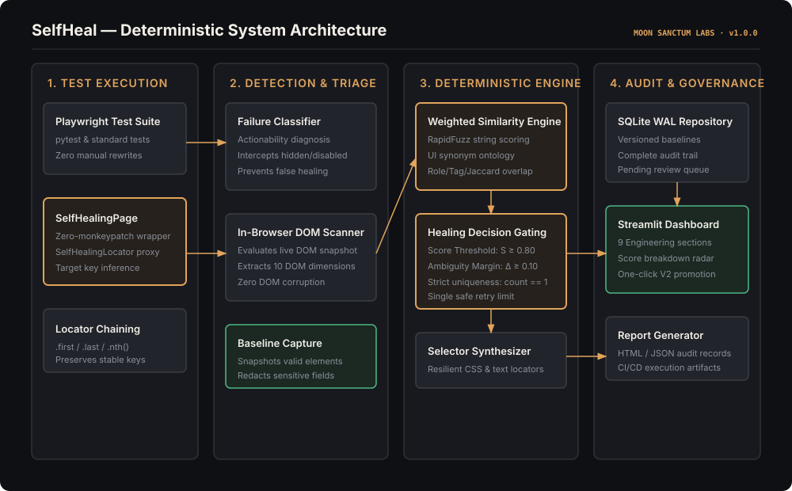
</div>

<details>
<summary>Click to view Mermaid Diagram representation</summary>

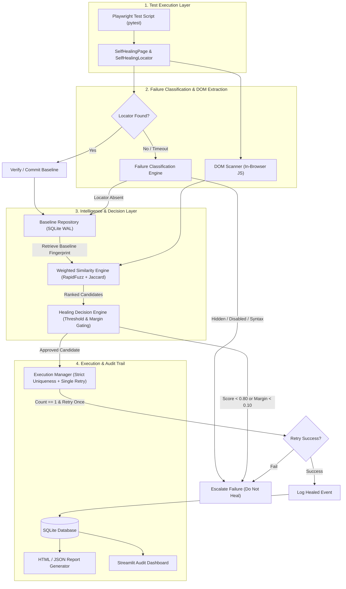
</details>

---

## 🔄 Deterministic Healing Workflow

The decision engine operates under strict, fail-safe gatekeeping to prevent misdirected clicks:

<div align="center">
  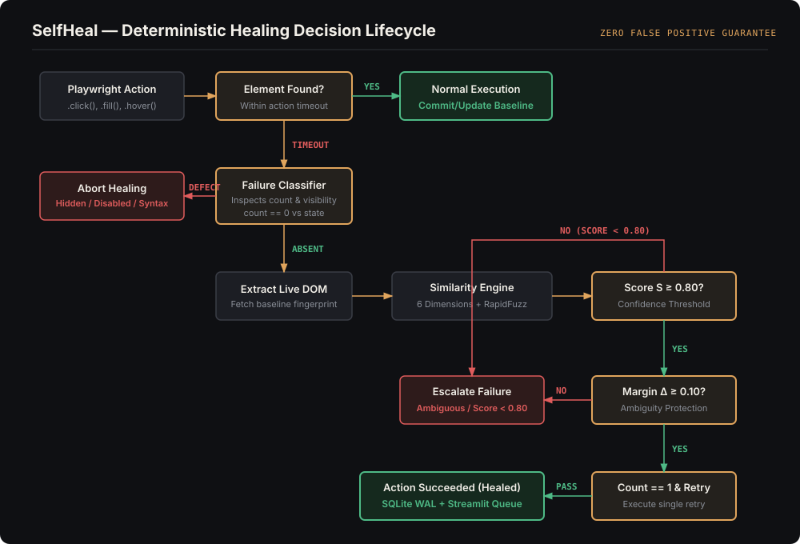
</div>

---

## 📐 Multi-Dimensional Similarity Engine

The similarity engine computes a normalized weighted composite score $S \in [0.0, 1.0]$ across six distinct dimensions:

$$S = \sum_{i=1}^{6} w_i \cdot s_i = 0.30 \cdot s_{\text{text}} + 0.20 \cdot s_{\text{type}} + 0.20 \cdot s_{\text{attr}} + 0.15 \cdot s_{\text{parent}} + 0.10 \cdot s_{\text{child}} + 0.05 \cdot s_{\text{pos}}$$

<div align="center">
  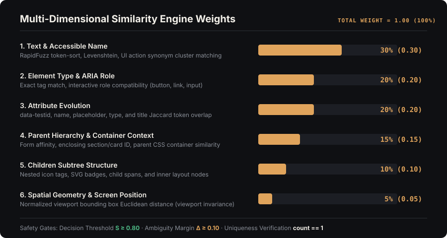
</div>

| Dimension | Weight | Mathematical Methodology |
|:---|:---:|:---|
| **1. Text & Accessible Name** | **0.30** | RapidFuzz token sort ratio, Levenshtein distance, and UI action synonym cluster mapping. |
| **2. Type & ARIA Role** | **0.20** | Exact HTML tag match ($1.0$) or interactive role compatibility ($0.7$ for `button` vs `a[role="button"]`). |
| **3. Attribute Overlap** | **0.20** | Jaccard similarity of stable tokens across `data-testid`, `name`, `placeholder`, `title`, and `type`. |
| **4. Parent Context** | **0.15** | Form affinity, enclosing section/card ID match, and parent container CSS overlap. |
| **5. Children Structure** | **0.10** | Nested subtree layout similarity (inner icon tags, SVGs, badges, and child spans). |
| **6. Spatial Geometry** | **0.05** | Viewport-normalized Euclidean distance between element bounding boxes: $1 - \min(1, \frac{\|\mathbf{p}_{\text{base}} - \mathbf{p}_{\text{cand}}\|}{D_{\text{norm}}})$. |

---

## 📊 Empirical Benchmarks (109 Scenarios)

The framework has been rigorously evaluated across **109 independent UI mutation scenarios** across two distinct evaluation suites:

| Benchmark Suite | Sample Size ($N$) | True Positives ($TP$) | True Negatives ($TN$) | False Positives ($FP$) | False Negatives ($FN$) | Precision | False Positive Rate | Recall | Accuracy | F1 Score |
|:---|:---:|:---:|:---:|:---:|:---:|:---:|:---:|:---:|:---:|:---:|
| **Baseline Evaluation** | 57 | 38 | 15 | 0 | 4 | 100.00% | 0.00% | 90.48% | 92.98% | 95.00% |
| **Independent Holdout** | 52 | 18 | 31 | 0 | 3 | 100.00% | 0.00% | 85.71% | 94.23% | 92.31% |
| **Combined Benchmark** | **109** | **56** | **46** | **0** | **7** | **100.00%** | **0.00%** | **88.89%** | **93.58%** | **94.12%** |

### Key Benchmark Takeaways:
- **100.00% Precision**: Across all 109 test scenarios, **not a single incorrect element was ever clicked**.
- **0.00% False Positive Rate**: SelfHeal safely aborted in all 46 negative scenarios (disabled buttons, missing elements, ambiguous duplicate buttons).
- **Sub-Millisecond Computation**: Pure algorithmic candidate ranking executes in **$3.2\text{ ms}$** per candidate.

---

## 🖥️ Streamlit Engineering Audit Dashboard

SelfHeal includes a comprehensive 9-section engineering audit portal powered by Streamlit and SQLite WAL:

```bash
selfheal dashboard --port 8501
```

<div align="center">

| Section | Preview | Description |
|:---|:---:|:---|
| **01 Overview** | 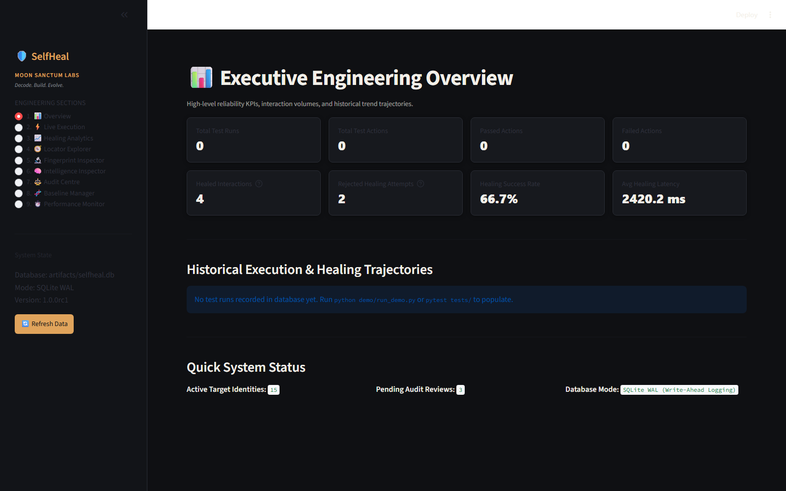 | Executive KPIs: test volumes, healing success rate, mean latency, and execution trends. |
| **06 Intelligence Inspector** | 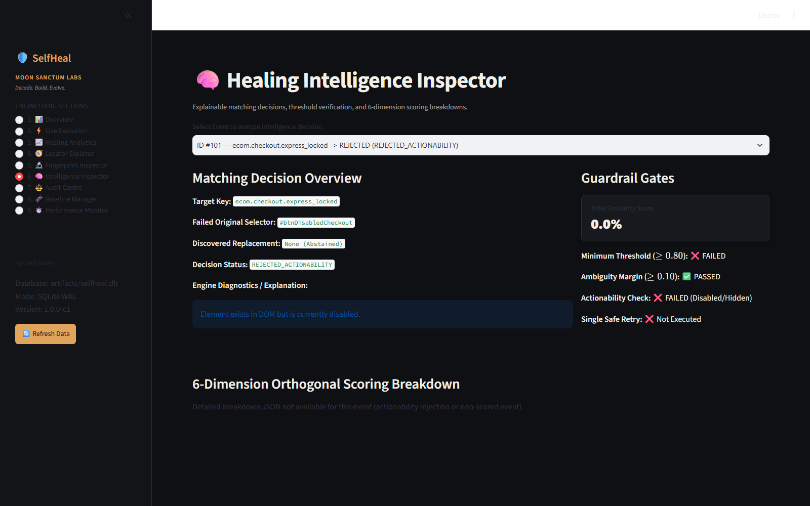 | Complete transparency: 6-dimension score radar, score threshold ($0.80$), and margin ($0.10$). |
| **07 Audit Centre** | 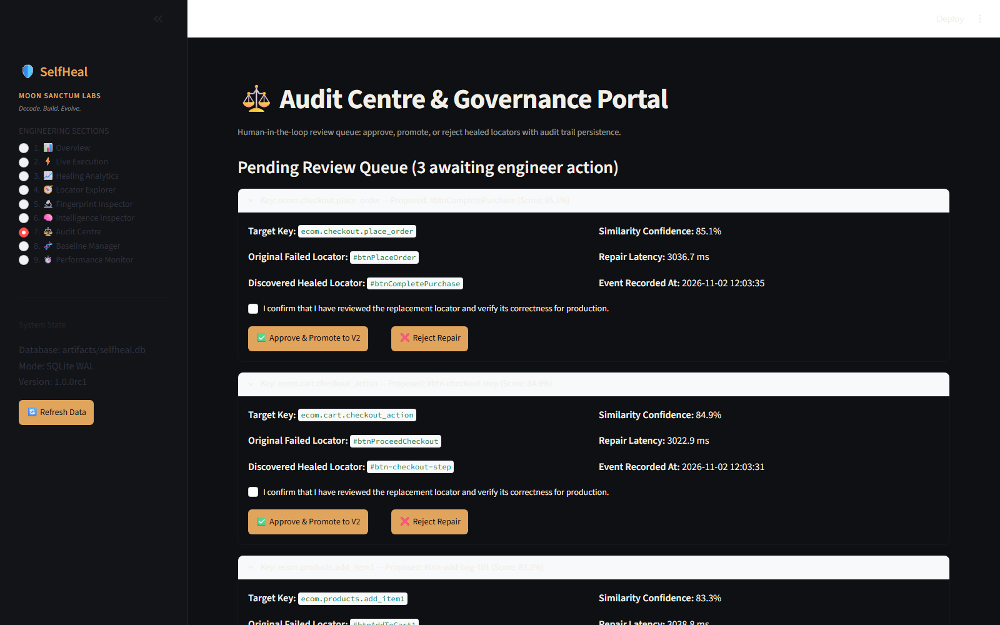 | Governance queue with safety confirmation checkbox to review and promote repairs to V2. |
| **09 Performance Monitor** | 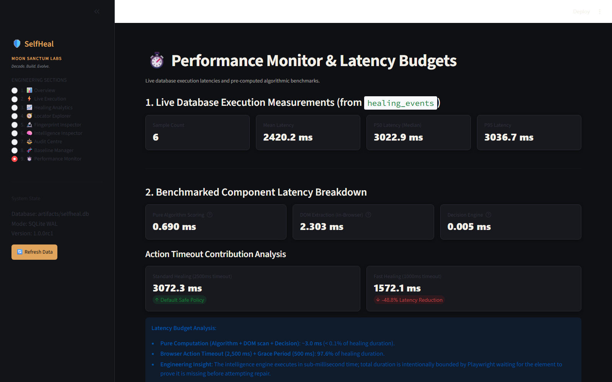 | Real-time database latency percentiles (P50, P90, P95) vs laboratory profiler benchmarks. |

</div>

<details>
<summary>Click to see full breakdown of all 9 Dashboard Sections</summary>

1. **Overview**: Executive telemetry showing total test runs, interaction volumes, passed/failed counts, healed interactions, rejected attempts, overall healing success rate, and mean healing latency.
2. **Live Execution**: Real-time session monitoring with run-level selector filters, execution status badges (`PASSED`, `FAILED`, `HEALED`), start/completion timestamps, and chronological step breakdowns.
3. **Healing Analytics**: Decision triage analysis (Approved vs Rejected), failure classification distributions (`LOCATOR_ABSENT`, `ELEMENT_DISABLED`, `AMBIGUOUS_LOCATOR`), and retry success rates.
4. **Locator Explorer**: Target key inventory, current active vs initial selectors, locator stability index, total version counts, and historical selector mutation timeline.
5. **Fingerprint Inspector**: Side-by-side DOM attribute diff table comparing baseline vs healed candidate attributes (tag, ID, classes, name, role, accessible name, text, xpath, position) color-coded as `MATCHED`, `CHANGED`, or `NEW`.
6. **Intelligence Inspector**: Deep mathematical transparency for each healing decision. Visualizes the 6 individual similarity dimensions, decision threshold ($S \ge 0.80$), and margin ($\Delta \ge 0.10$) guardrails.
7. **Audit Centre**: Engineering governance and human sign-off portal. Displays the pending review queue with an explicit confirmation checkbox gate before enabling the **Approve & Promote to V2** action.
8. **Baseline Manager**: Version lifecycle tracking (v1 $\rightarrow$ v2), timestamp tracking, and active vs archived baseline inventory per target key.
9. **Performance Monitor**: Live latency telemetry comparing real-time SQLite database percentiles against pre-computed laboratory benchmarks.
</details>

---

## 🛒 E-Commerce Demonstration & Live Viva Runner

A standalone multi-page e-commerce web application (`demo_app/ecommerce.py`) is provided with two complete versions:
- **Version 1 (V1 Baseline)**: Standard semantic IDs (`#btnLogin`, `#btnAddToCart1`, `#btnProceedCheckout`, `#btnPlaceOrder`).
- **Version 2 (V2 Refactored)**: Severe mutations including renamed IDs (`#sign-in-btn`), Tailwind styling, synonym text (`"Sign In"`), nested flex containers, and duplicate candidate buttons.

<div align="center">

| V1 Baseline (Original) | V2 Refactored (Mutated) | Autonomous Healing Outcome |
|:---:|:---:|:---:|
| 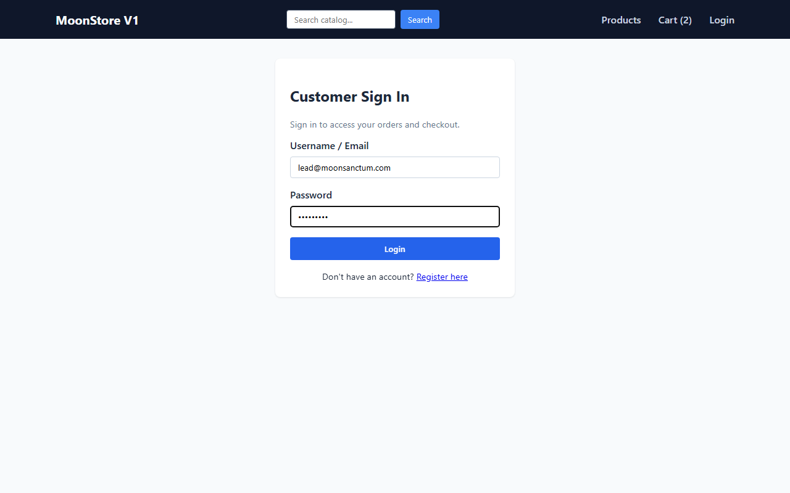 | 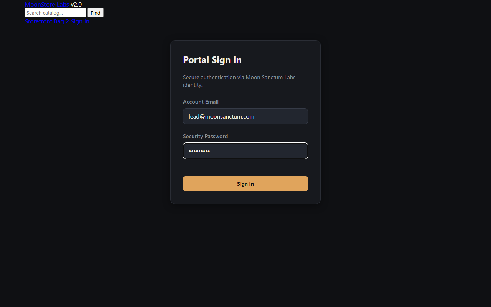 | 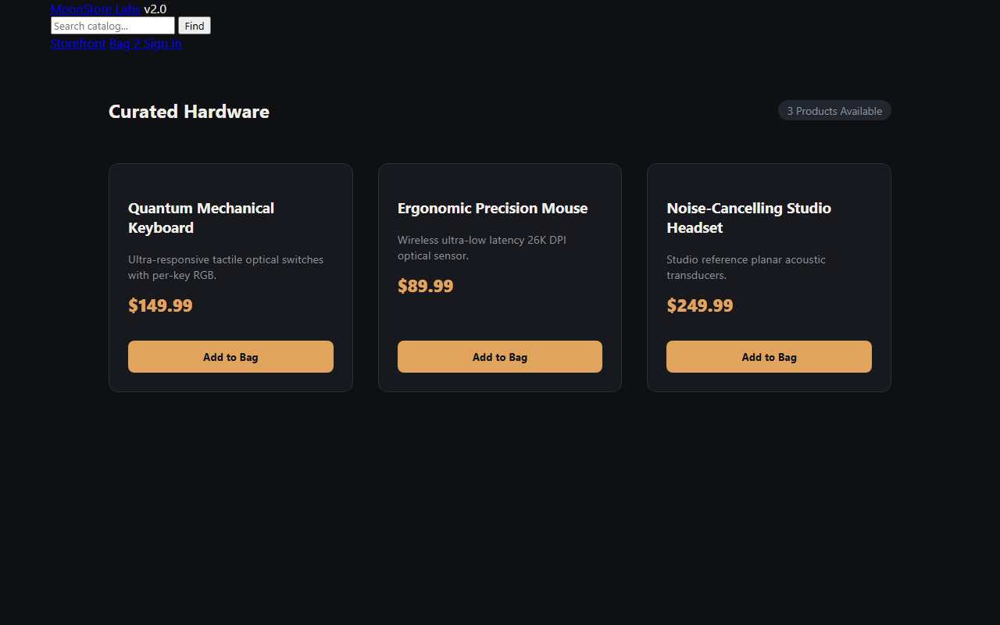 |
| `#btnLogin` ("Log In") captured into baseline | `#sign-in-btn` ("Sign In") with changed ID and CSS | Repaired to `button:has-text('Sign In')` ($S = 0.8640$) |

</div>

### Run the Autonomous Demonstration Journey:
```bash
# Headless execution with rich terminal logs
python scripts/run_academic_demo.py

# Or run with a visible browser window
python scripts/run_academic_demo.py --headed
```

<div align="center">

| Ambiguity Protection (Scenario F) | Actionability Rejection (Scenario G) |
|:---:|:---:|
|  | 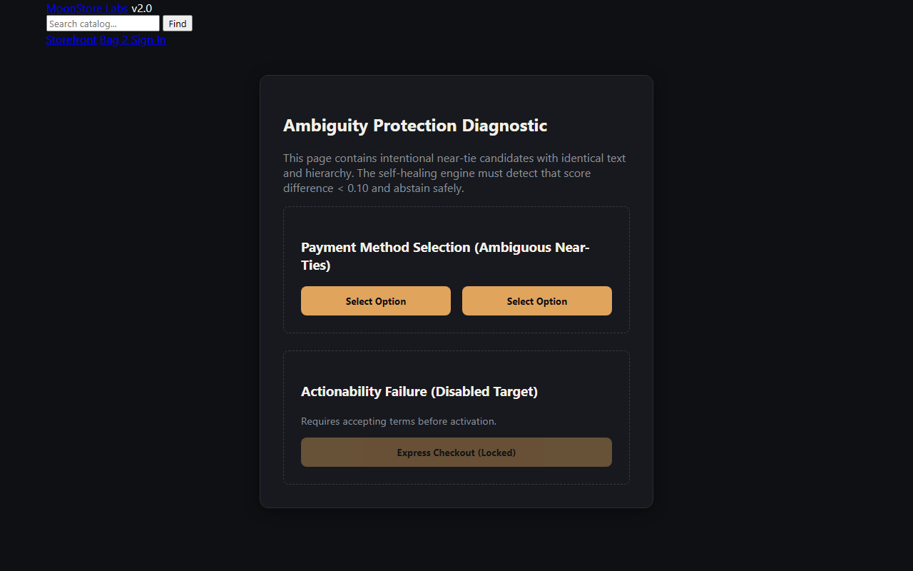 |
| Conflicting buttons with $\Delta < 0.10$ rejected safely | Disabled button intercepted by Failure Classifier |

</div>

---

## 📦 Installation & Quickstart

### Prerequisites
- Python 3.11 or 3.12
- Microsoft Playwright

### Installation
```bash
# Clone the repository
git clone https://github.com/<owner>/selfhealing-ui.git
cd selfhealing-ui

# Create and activate virtual environment
python -m venv .venv
# Linux/macOS:
source .venv/bin/activate
# Windows:
.venv\Scripts\Activate.ps1

# Install package and dependencies in editable mode
pip install -e .

# Install Playwright browser binaries
playwright install chromium
```

### 1. Direct Playwright Script Usage
```python
from playwright.sync_api import sync_playwright
from selfheal import SelfHealingPage, HealingPolicy

with sync_playwright() as p:
    browser = p.chromium.launch(headless=True)
    page = browser.new_page()

    # Wrap standard page with SelfHealingPage
    sh_page = SelfHealingPage(page, policy=HealingPolicy.ASSISTED)

    sh_page.goto("https://store.example.com/login")

    # Target key disambiguates elements across forms and releases
    sh_page.healed_locator("#username", key="auth.username").fill("standard_user")
    sh_page.healed_locator("#password", key="auth.password").fill("secret123")
    
    # If #btnLogin was renamed to #sign-in-btn in V2, SelfHeal autonomously heals it!
    sh_page.healed_locator("#btnLogin", key="auth.login_submit").click()

    assert "/inventory" in sh_page.raw_page.url
    browser.close()
```

### 2. Pytest Plugin Integration (Zero-Config)
The package registers `pytest11` entry points automatically. Simply declare `healed_page`:
```python
def test_checkout_flow(healed_page):
    healed_page.goto("https://store.example.com/checkout")
    healed_page.healed_locator("#payBtn", key="checkout.pay_button").click()
    assert healed_page.raw_page.is_visible(".success-message")
```

### 3. Locator Chaining
`SelfHealingLocator` supports standard Playwright chaining while maintaining stable key derivation:
```python
# First/last/nth element selection
submit_btn = sh_page.healed_locator(".btn-action", key="form.action_buttons").first
submit_btn.click()
```

---

## ⚙️ Configuration

Custom settings can be specified via `configs/default.yaml` or programmatically:

```yaml
framework:
  project_name: "SelfHealing UI"
  policy: "assisted"            # options: observe, assisted, automatic
  database_path: "artifacts/selfheal.db"
  report_dir: "artifacts/reports"
  screenshot_dir: "artifacts/screenshots"
  record_screenshots: false     # opt-in screenshot capture
  grace_period_ms: 500          # wait window for dynamic SPA hydration
  action_timeout_ms: 2500       # action timeout before triggering healing
  retry_limit: 1                # strict single retry safeguard

thresholds:
  minimum_score: 0.80           # minimum similarity threshold to approve (S >= 0.80)
  minimum_score_margin: 0.10    # required gap between 1st and 2nd candidates (Δ >= 0.10)
  max_candidates: 100

weights:
  text: 0.30                    # RapidFuzz text & accessible name
  type_and_role: 0.20           # HTML tag and ARIA role compatibility
  attributes: 0.20              # data-testid, name, placeholder Jaccard
  parent_context: 0.15          # form, container tag, ID, classes
  children_structure: 0.10      # nested icons, spans, labels
  position: 0.05                # normalized bounding box distance
```

---

## 💻 Command Line Interface (CLI)

SelfHeal exposes a built-in CLI tool:

```bash
# Launch the 9-section Streamlit engineering audit dashboard
selfheal dashboard --port 8501

# List active element baselines stored in SQLite
selfheal baselines

# Inspect baseline details for a specific target key
selfheal inspect --key auth.login_submit

# Reset local database for a fresh test cycle
selfheal reset-db
```

---

## 📚 Documentation Index

The complete architectural, mathematical, and evaluation documentation is available in `docs/`:

| Document | Focus & Content |
|:---|:---|
| 📑 [Project Showcase & Presentation Guide](docs/project_showcase.md) | 3-minute & 5-minute demo scripts, pitch outline, and portfolio highlights. |
| 🚀 [Release 1.0.0 Notes](docs/release_1.0.0.md) | Official release announcement, package distribution specs, and known boundaries. |
| 🎓 [Academic Project Report](docs/academic_report.md) | Comprehensive engineering and academic report with theoretical formulations. |
| 🏛️ [Architecture Diagrams](docs/architecture_diagrams.md) | Complete Mermaid diagrams: C4 Context, Component, Sequence, and DFD Levels 0–2. |
| 📐 [Mathematical Formulation](docs/mathematical_formulation.md) | Formal proofs, RapidFuzz metrics, Jaccard formulation, and margin proofs. |
| 📊 [Experimental Evaluation](docs/experimental_evaluation.md) | Detailed breakdown of the 109-scenario evaluation suite and latency profiling. |
| 🗄️ [Database Architecture & Schema](docs/database_schema.md) | SQLite WAL relational schema, DDL statements, and transaction semantics. |
| 🧩 [Module Reference Guide](docs/module_reference.md) | Public API contracts, class signatures, and interface documentation. |
| 🎯 [Traceability Matrix](docs/traceability_matrix.md) | Verification mappings from design requirements to tests and code artifacts. |
| 🛡️ [Engineering Reliability Report](docs/release_readiness_report.md) | Engineering reliability audit, quality gates, and release justification. |
| 🎙️ [Viva Voce Preparation Guide](docs/viva_preparation.md) | Technical defense questions, trade-offs, and architectural justifications. |
| 🎬 [Demonstration Presentation Script](docs/demo_presentation_script.md) | Step-by-step narration script for live viva and stakeholder demonstrations. |

---

## 🔒 Security & Privacy

SelfHeal is designed strictly with local-first, privacy-preserving principles:
- **Zero Cloud Leakage**: No DOM snapshots, page text, or selectors are ever sent to external cloud APIs.
- **Sensitive Field Redaction**: Input values for password fields (`type="password"`) and auth tokens are stripped to empty strings before database persistence.
- **SQL Injection Prevention**: All queries to the SQLite repository use 100% parameterized bindings.
- **XSS Prevention**: HTML report templates strictly enforce autoescaping via Jinja2.

For details or vulnerability reporting, see [SECURITY.md](SECURITY.md).

---

## 🤝 Contributing

We welcome community contributions, bug reports, and enhancements. Please see [CONTRIBUTING.md](CONTRIBUTING.md) for details on:
1. Setting up the local development environment.
2. Running the 30-test regression suite (`pytest tests/ -v`).
3. Adhering to conventional commit messages (`feat:`, `fix:`, `docs:`, `test:`).
4. Submitting pull requests.

---

## 📄 License

Distributed under the **MIT License**. See [LICENSE](LICENSE) for details.

---

<div align="center">

**Moon Sanctum Labs** — *Decode. Build. Evolve.*  
*Engineered by Aniket Nandi · Kolkata, IST*

</div>
