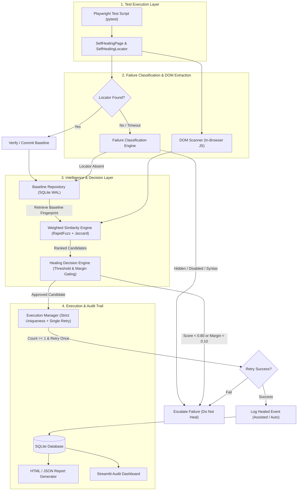

# Self-Healing UI Automation Framework

**Version:** 1.0.0  
**Moon Sanctum Labs** — *Decode. Build. Evolve.*  
**Lead Engineer:** Aniket Nandi (Kolkata, IST)

A production-grade, deterministic self-healing test automation framework for Microsoft Playwright in Python. Autonomously recovers broken DOM locators caused by routine UI refactoring without brittle monkey-patching, unbounded retries, or non-deterministic LLM hallucinations.

---

## 🏛️ System Architecture



---

## 🚀 Key Architectural Principles

1. **Deterministic Intelligence (No LLMs)**: Structured element matching using RapidFuzz string metrics (Levenshtein, Jaro-Winkler, token sort), UI action synonym ontology, tag/ARIA role compatibility, attribute evolution Jaccard overlap, parent hierarchy, and normalized spatial geometry.
2. **Failure Classification Engine**: Triage distinguishes true locator absence (`count == 0`) from actionability defects (`ELEMENT_HIDDEN`, `ELEMENT_DISABLED`, `AMBIGUOUS_LOCATOR`, `INVALID_SELECTOR`, `ASSERTION_FAILURE`).
3. **Safe Composition & Delegation**: Uses `SelfHealingPage` and `SelfHealingLocator` wrapping Playwright objects cleanly without mutating global internals or monkey-patching libraries.
4. **Stable Element Identities**: Supports explicit and inferred `target_key` (e.g. `auth.login_submit`) to disambiguate identical buttons across forms or pages.
5. **Conservative Healing Policy**: Requires minimum similarity ($\ge 0.80$), confidence margin ($\ge 0.10$ between 1st and 2nd candidates to eliminate ties), strict candidate uniqueness verification (`count == 1`), and retries an action **only once**.
6. **Auditable SQLite WAL Persistence**: Versioned baselines, pending review workflows, locator evolution tracking, and complete privacy safeguards (passwords, tokens, and input values are automatically redacted).
7. **Streamlit Audit Dashboard**: Interactive web portal for QA engineers to review before/after locators, inspect score breakdowns, and one-click promote or reject repairs.

---

## 📊 Comprehensive Empirical Evaluation (109 Scenarios)

The framework has been evaluated across **109 independent UI mutation scenarios** across two distinct test suites:

### 1. Baseline Evaluation Dataset (57 Scenarios)
- **Scenarios Evaluated**: 57
- **Healing Precision**: **100.00%** (0 false positive interactions dispatched)
- **Healing Recall**: **90.48%** (38/42 eligible modifications repaired)
- **False Positive Rate (FPR)**: **0.00%**
- **Overall Accuracy**: **92.98%**

### 2. Independent Holdout Validation Dataset (52 Unseen Scenarios)
- **Scenarios Evaluated**: 52
- **Healing Precision**: **100.00%** (0 false positive interactions dispatched)
- **Healing Recall**: **85.71%** (18/21 eligible modifications repaired)
- **False Positive Rate (FPR)**: **0.00%**
- **Overall Accuracy**: **94.23%** (49/52)
- **F1 Score**: **92.31%**
- **Abstention Rate**: **65.38%**

### 3. Combined Benchmark Totals
| Metric | Baseline Suite (57) | Holdout Suite (52) | **Combined (109 Scenarios)** |
|---|---|---|---|
| **True Positives (TP)** | 38 | 18 | **56** |
| **True Negatives (TN)** | 15 | 31 | **46** |
| **False Positives (FP)** | 0 | 0 | **0 (0.00%)** |
| **False Negatives (FN)** | 4 | 3 | **7** |
| **Healing Precision** | 100.00% | 100.00% | **100.00%** |
| **False Positive Rate** | 0.00% | 0.00% | **0.00%** |
| **Healing Recall** | 90.48% | 85.71% | **88.89%** |
| **Overall Accuracy** | 92.98% | 94.23% | **93.58%** |
| **F1 Score** | 95.00% | 92.31% | **94.12%** |

---

## ⚡ Multi-Tier Performance Benchmarks (500+ Iterations)

Performance measured across 500 iterations on live Chromium (with 50 warm-up runs):

| Component / Layer | Mean (ms) | Median (P50) | 90th %ile (P90) | 95th %ile (P95) | Notes |
|---|---|---|---|---|---|
| **Pure Algorithm Scoring** | **0.69 ms** | **0.61 ms** | **0.81 ms** | **1.13 ms** | 50 candidates scored across 6 dimensions |
| **Decision Engine** | **0.005 ms** | **0.004 ms** | **0.008 ms** | **0.012 ms** | Confidence threshold & margin gating |
| **DOM Extraction (in-browser)** | **2.30 ms** | **2.18 ms** | **2.99 ms** | **3.21 ms** | Native JS evaluation via `page.evaluate()` |
| **Normal Execution Overhead** | **23.72 ms** | **23.34 ms** | **27.09 ms** | **28.88 ms** | Present element action via `SelfHealingLocator` |
| **Standard Healing (2500ms timeout)** | **3,072.27 ms** | **3,071.61 ms** | **3,094.55 ms** | **3,099.12 ms** | Timeout (2500ms) + Grace (500ms) + Retry |
| **Fast Healing (1000ms timeout)** | **1,572.06 ms** | **1,567.89 ms** | **1,591.01 ms** | **1,591.69 ms** | 48.8% latency reduction with `action_timeout_ms: 1000` |
| **Rejected Healing (Actionability)** | **1,356.23 ms** | **1,356.16 ms** | **1,363.33 ms** | **1,367.06 ms** | Fast short-circuit on disabled/hidden elements |

### Latency Budget Breakdown:
- **Playwright Action Timeout (2,500 ms)** accounts for **81.37%** of browser healing time.
- **Dynamic Element Grace Period (500 ms)** accounts for **16.27%** of browser healing time.
- **Pure Computation Overhead** (Algorithm + Decision + DOM scan) is **2.998 ms** ($< 0.1\%$ of total time).
- Configuring `action_timeout_ms: 1000` cuts browser healing latency down to **~1.57 seconds** without compromising dynamic element recognition.

---

## 🛠️ Installation & Setup

### 1. Requirements
- Python 3.11 or 3.12
- Node.js (for Playwright browser binaries)

### 2. Install from Wheel or Source
```bash
# Clone the repository
git clone https://github.com/moonsanctum/selfhealing-ui.git
cd selfhealing-ui

# Install dependencies and package in editable mode
pip install -r requirements.txt
pip install -e .

# Install Playwright Chromium browser
playwright install chromium
```

---

## 💻 Framework API Reference

### 1. Writing Tests with `SelfHealingPage`

```python
from selfheal import SelfHealingPage

def test_user_authentication(page):
    # Initialize wrapper
    sh_page = SelfHealingPage(page)
    sh_page.goto("https://app.example.com/login")

    # Bind interactions to stable logical keys
    sh_page.healed_locator("#username", key="auth.username").fill("jane_doe")
    sh_page.healed_locator("#password", key="auth.password").fill("secret123")

    # If #loginBtn is renamed to #signinBtn, the engine heals it automatically!
    sh_page.healed_locator("#loginBtn", key="auth.submit_button").click()

    assert "/dashboard" in sh_page.raw_page.url
```

### 2. Pytest Plugin Integration (Zero-Config)
The package registers `pytest11` entry points automatically. You can consume `healed_page` directly without manual imports:
```python
def test_checkout(healed_page):
    healed_page.goto("https://store.example.com/checkout")
    healed_page.healed_locator("#payBtn", key="checkout.pay_button").click()
```

### 3. Locator Chaining
`SelfHealingLocator` supports standard chaining methods while preserving stable key derivation:
```python
# Chaining with first, last, nth
submit_btn = sh_page.healed_locator(".btn-action", key="form.action_buttons").first
submit_btn.click()

cancel_btn = sh_page.healed_locator(".btn-action", key="form.action_buttons").last
cancel_btn.click()
```

---

## ⚙️ Configuration (`configs/default.yaml`)

```yaml
framework:
  project_name: "SelfHealing UI"
  policy: "assisted"            # options: observe, assisted, automatic
  database_path: "artifacts/selfheal.db"
  report_dir: "artifacts/reports"
  screenshot_dir: "artifacts/screenshots"
  record_screenshots: false     # opt-in screenshot capture
  grace_period_ms: 500          # wait window for dynamic SPA hydration
  action_timeout_ms: 2500       # action timeout before triggering healing
  retry_limit: 1

thresholds:
  minimum_score: 0.80           # minimum similarity threshold to approve
  minimum_score_margin: 0.10    # required gap between 1st and 2nd candidates
  max_candidates: 100

weights:
  text: 0.30                    # RapidFuzz text & accessible name
  type_and_role: 0.20           # HTML tag and ARIA role compatibility
  attributes: 0.20              # data-testid, name, placeholder Jaccard
  parent_context: 0.15          # form, container tag, ID, classes
  children_structure: 0.10      # nested icons, spans, labels
  position: 0.05                # normalized bounding box distance
```

---

## 🎓 Academic Demonstration & Live Viva Runner

A standalone, self-contained multi-page e-commerce web application (`demo_app/ecommerce.py`) is provided with two complete versions:
- **Version 1 (V1 Baseline)**: Standard semantic IDs (`#btnLogin`, `#btnAddToCart1`, `#btnProceedCheckout`, `#btnPlaceOrder`).
- **Version 2 (V2 Refactored)**: Complex visual and structural UI mutations (kebab-case IDs, Tailwind styling, multi-word semantic synonyms, nested container changes).

### 1. Run the Complete 12-Step Academic Journey (One Command)
```bash
# Headless autonomous execution with colored terminal logs
python scripts/run_academic_demo.py

# Or run with a visible browser window for live viva demonstration
python scripts/run_academic_demo.py --headed
```
The demonstration proves:
1. **Unchanged Test Scripts**: Version 2 runs the exact same code written for Version 1.
2. **Deterministic Healing**: Repairs 4/4 broken locators with average score $\ge 0.84$.
3. **Multi-Card Disambiguation**: Uses accessible names to disambiguate 3 identical "Add to Bag" buttons in the product grid without misclicks.
4. **Safety Guardrail 1 (Ambiguity Margin < 0.10)**: Prevents accidental interaction on near-tie payment buttons (`REJECTED_AMBIGUOUS_MATCH`).
5. **Safety Guardrail 2 (Actionability Failure)**: Intercepts disabled checkout button (`REJECTED_ACTIONABILITY`).
6. **Baseline Promotion**: Promotes repaired locators to Version 2 in SQLite WAL with human QA sign-off.

---

## 🖥️ Streamlit Audit & Engineering Monitoring Dashboard

The dashboard provides an enterprise-grade engineering monitoring, audit, and governance control interface. Every displayed metric and table is dynamically queried from the local SQLite WAL database (`artifacts/selfheal.db`).

### Launching Dashboard
```bash
selfheal dashboard --port 8501
# Or directly via streamlit:
streamlit run src/selfheal/dashboard/app.py
```
Navigate to `http://localhost:8501` to access the 9 core modules via the sidebar:

1. **Overview**: Executive telemetry showing total test runs, interaction volumes, passed/failed counts, healed interactions, rejected attempts, overall healing success rate, and mean healing latency. Includes historical execution trend charts.
2. **Live Execution**: Real-time session monitoring with run-level selector filters, execution status badges (`PASSED`, `FAILED`, `HEALED`), start/completion timestamps, and chronological step breakdowns.
3. **Healing Analytics**: Decision triage analysis (Approved vs Rejected), failure classification distributions (`LOCATOR_ABSENT`, `ELEMENT_DISABLED`, `AMBIGUOUS_LOCATOR`, etc.), single-retry success rates, and similarity score distributions.
4. **Locator Explorer**: Target key inventory, current active vs initial selectors, locator stability index, total version counts, interception frequency, and historical selector mutation timeline.
5. **Fingerprint Inspector**: Side-by-side DOM attribute diff table comparing baseline vs healed candidate attributes (tag, ID, classes, name, role, accessible name, placeholder, text, xpath, position). Highlights attributes as `MATCHED`, `CHANGED`, or `NEW`.
6. **Intelligence Inspector**: Deep mathematical transparency for each healing decision. Visualizes the 6 individual similarity dimensions (Text 30%, Tag/Role 20%, Attributes 20%, Parent 15%, Children 10%, Geometry 5%), decision threshold ($S \ge 0.80$) and margin ($\Delta \ge 0.10$) guardrails, and natural language decision explanations.
7. **Audit Centre**: Engineering governance and human sign-off portal. Displays the pending review queue with an explicit confirmation checkbox gate before enabling the **Approve & Promote to V2** action, or allows QA engineers to **Reject Repair** and leave notes.
8. **Baseline Manager**: Version lifecycle tracking (v1 $\rightarrow$ v2), timestamp tracking, and active vs archived baseline inventory per target key.
9. **Performance Monitor**: Live latency telemetry comparing real-time SQLite database percentiles (P50, P90, P95, Min, Max) against pre-computed laboratory benchmarks. Explains the latency breakdown (Playwright timeout vs grace period vs pure algorithmic matching).

---

## 🧪 Running Tests & Benchmarks

```bash
# Run all 30 unit, integration, edge case, and e-commerce healing tests
python -m pytest tests/ -v

# Run the 57-scenario baseline evaluation benchmark
python tests/evaluation/benchmark.py

# Run the 52-scenario independent holdout validation
python tests/evaluation/holdout_benchmark.py

# Run the action timeout (1000ms vs 2500ms) and 15-case negative evaluation
python tests/evaluation/timeout_investigation.py

# Run the multi-tier performance profiler (500+ iterations)
python tests/evaluation/profile_performance.py

# List active baseline element fingerprints
selfheal baselines

# Reset database for fresh test execution
selfheal reset-db
```

---

## 🔒 Security & Privacy

The framework follows privacy-preserving, local-first design principles. For details, see [SECURITY.md](SECURITY.md).
- **Password Redaction**: Password values and inner text are suppressed to empty strings before database persistence.
- **XSS Prevention**: HTML report templates strictly enforce autoescaping via Jinja2.
- **SQLi Prevention**: All SQLite queries are 100% parameterized.
- **Zero Cloud Leakage**: No DOM snapshots or selectors are transmitted to third-party LLMs or cloud endpoints.

---

## 📄 License

Distributed under the [MIT License](LICENSE). Copyright (c) 2026 Moon Sanctum Labs.
