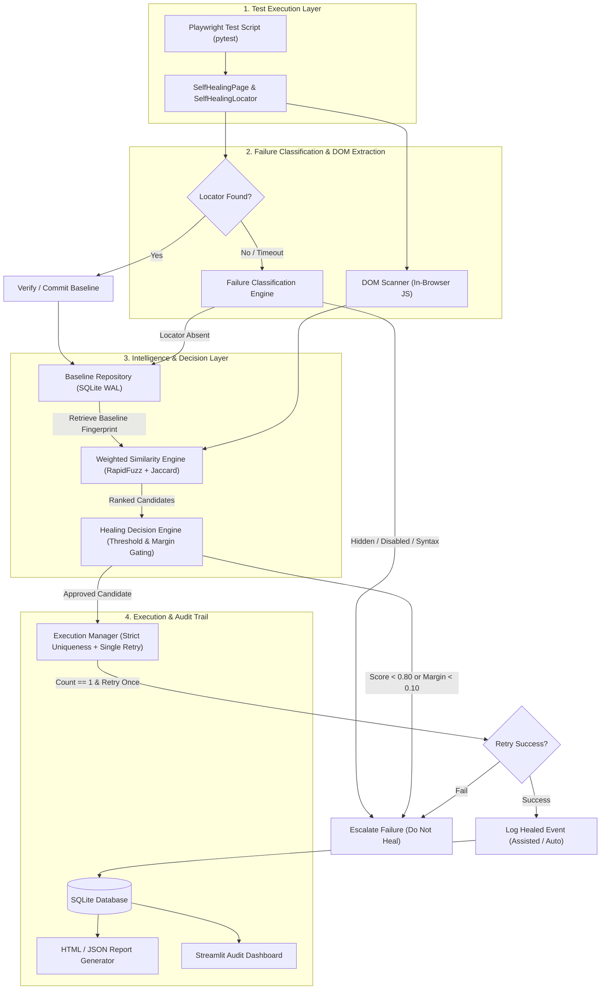

# Self-Healing UI Automation Framework

**Moon Sanctum Labs** — *Decode. Build. Evolve.*  
**Lead Engineer:** Aniket Nandi (Kolkata, IST)

A production-grade, deterministic self-healing test automation framework for Microsoft Playwright in Python. Autonomously recovers broken DOM locators caused by routine UI refactoring without brittle monkey-patching, unbounded retries, or non-deterministic LLM hallucinations.

---

## 🏛️ System Architecture



---

## 🚀 Key Architectural Principles

1. **Deterministic Intelligence (No LLMs)**: Structured element matching using RapidFuzz string metrics (Jaro-Winkler, token sort), UI action synonym ontology, tag/ARIA role compatibility, attribute Jaccard overlap, parent hierarchy, and normalized spatial geometry.
2. **Failure Classification Engine**: Triage distinguishes true locator absence (`count == 0`) from actionability defects (`ELEMENT_HIDDEN`, `ELEMENT_DISABLED`, `AMBIGUOUS_LOCATOR`, `INVALID_SELECTOR`, `ASSERTION_FAILURE`).
3. **Safe Composition & Delegation**: Uses `SelfHealingPage` and `SelfHealingLocator` wrapping Playwright objects cleanly without mutating global internals or monkey-patching libraries.
4. **Stable Element Identities**: Supports explicit and inferred `target_key` (e.g. `auth.login_submit`) to disambiguate identical buttons across forms or pages.
5. **Conservative Healing Policy**: Requires minimum similarity ($\ge 0.80$), confidence margin ($\ge 0.10$ between 1st and 2nd candidates to eliminate ties), strict candidate uniqueness verification (`count == 1`), and retries an action **only once**.
6. **Auditable SQLite WAL Persistence**: Versioned baselines, pending review workflows, locator evolution tracking, and complete privacy safeguards (passwords, tokens, and input values are automatically redacted).
7. **Streamlit Audit Dashboard**: Interactive web portal for QA engineers to review before/after locators, inspect score breakdowns, and one-click promote or reject repairs.

---

## 📊 Empirical Evaluation & Benchmark (57 Scenarios)

Evaluated across **57 independent, diverse UI mutation scenarios** across 12 distinct categories:

| Category | Total Scenarios | Passed | Result |
|---|---|---|---|
| **Renamed IDs** (kebab, camel, snake, hash, prefixes) | 6 | 6 | 100.0% |
| **Changed CSS Classes** (Tailwind, BEM, Bootstrap) | 6 | 6 | 100.0% |
| **Modified Text** (casing, whitespace, affixes) | 6 | 5 | 83.3% |
| **Semantic Synonyms** (Login/Sign In, Register/Sign Up) | 8 | 8 | 100.0% |
| **DOM Restructuring** (wrappers, card footers, grids) | 5 | 5 | 100.0% |
| **Spatial Shifts & Reordering** (moved, widened) | 4 | 4 | 100.0% |
| **Cross-Tag Mutations** (button $\leftrightarrow$ anchor $\leftrightarrow$ input) | 4 | 1 | 25.0% |
| **Context Disambiguation** (form vs footer vs header) | 3 | 3 | 100.0% |
| **Ambiguous Candidates** (margin $< 0.10$ ties) | 4 | 4 | 100.0% (Rejected) |
| **Missing / Removed Targets** (target deleted) | 4 | 4 | 100.0% (Rejected) |
| **Actionability Defects** (hidden, disabled) | 4 | 4 | 100.0% (Rejected) |
| **Syntax & Assertion Errors** (invalid selectors) | 3 | 3 | 100.0% (Rejected) |

### Aggregate Metrics:
- **Total Scenarios Evaluated**: 57
- **Healing Precision**: **100.00%** (0 false positive interactions dispatched)
- **Healing Recall**: **90.48%** (38/42 eligible modifications repaired)
- **False Positive Rate (FPR)**: **0.00%** (Target: $< 5\%$)
- **Overall Accuracy**: **92.98%**

---

## ⚡ Multi-Tier Performance Benchmarks

Performance profile measured across 50 iterations on live Chromium:

| Tier / Component | Mean Latency | Median (P50) | 95th Percentile (P95) | Description |
|---|---|---|---|---|
| **Pure Algorithm Engine** | **0.53 ms** | **0.47 ms** | **1.08 ms** | Candidate scoring & decision logic (50 candidates) |
| **DOM Extraction (in-browser)** | **3.56 ms** | **2.93 ms** | **6.77 ms** | JavaScript evaluation via `page.evaluate()` |
| **Normal Execution Overhead** | **24.09 ms** | **22.19 ms** | **25.51 ms** | Present element action via `SelfHealingLocator` |
| **Full Browser Healing Cycle** | **3,099.55 ms** | **3,073.40 ms** | **3,103.06 ms** | Timeout (2500ms) + Grace (500ms) + Scan + Retried Click |

> [!NOTE]
> The algorithmic healing decision executes in sub-millisecond time ($< 1\text{ ms}$). The full browser cycle is dominated by Playwright's action timeout and dynamic grace window, ensuring genuine elements are given time to appear before healing begins.

---

## 🛠️ Installation & Setup

### 1. Requirements
- Python 3.11 or 3.12
- Node.js (for Playwright browser binaries)

### 2. Install Package
```bash
# Clone the repository
git clone https://github.com/your-org/self-healing-ui-automation.git
cd self-healing-ui-automation

# Install dependencies and editable package
pip install -r requirements.txt
pip install -e .

# Install Playwright Chromium browser
playwright install chromium
```

---

## 💻 Framework API Reference

### 1. Writing Tests with `SelfHealingPage`

```python
from selfheal import SelfHealingPage

def test_user_authentication(page):
    # Initialize wrapper
    sh_page = SelfHealingPage(page)
    sh_page.goto("https://app.example.com/login")

    # Bind interactions to stable logical keys
    sh_page.healed_locator("#username", key="auth.username").fill("jane_doe")
    sh_page.healed_locator("#password", key="auth.password").fill("secret123")

    # If #loginBtn is renamed to #signinBtn, the engine heals it automatically!
    sh_page.healed_locator("#loginBtn", key="auth.submit_button").click()

    assert "/dashboard" in sh_page.raw_page.url
```

### 2. Locator Chaining
`SelfHealingLocator` supports standard chaining methods while preserving stable key derivation:
```python
# Chaining with first, last, nth
submit_btn = sh_page.healed_locator(".btn-action", key="form.action_buttons").first
submit_btn.click()

cancel_btn = sh_page.healed_locator(".btn-action", key="form.action_buttons").last
cancel_btn.click()
```

### 3. Pytest Fixture Integration
Use the built-in `healed_page` fixture directly in test functions:
```python
def test_checkout(healed_page):
    healed_page.goto("https://store.example.com/checkout")
    healed_page.healed_locator("#payBtn", key="checkout.pay_button").click()
```

---

## ⚙️ Configuration (`configs/default.yaml`)

```yaml
framework:
  project_name: "SelfHealing UI"
  policy: "assisted"            # options: observe, assisted, automatic
  database_path: "artifacts/selfheal.db"
  report_dir: "artifacts/reports"
  grace_period_ms: 500          # wait window for dynamic SPA hydration
  retry_limit: 1

thresholds:
  minimum_score: 0.80           # minimum similarity threshold to approve
  minimum_score_margin: 0.10    # required gap between 1st and 2nd candidates
  max_candidates: 100

weights:
  text: 0.30                    # RapidFuzz text & accessible name
  type_and_role: 0.20           # HTML tag and ARIA role compatibility
  attributes: 0.20              # data-testid, name, placeholder Jaccard
  parent_context: 0.15          # form, container tag, ID, classes
  children_structure: 0.10      # nested icons, spans, labels
  position: 0.05                # normalized bounding box distance
```

### Operating Policies:
- **`observe`**: Detects and logs candidate repairs, but never dispatches retries.
- **`assisted`** *(Default)*: Repairs the locator in memory, retries the action, and logs a `pending_review` event in the database for engineer approval.
- **`automatic`**: Repairs, retries, and automatically promotes the healed locator into the active baseline repository.

---

## 🖥️ Streamlit Audit Dashboard & Reports

### 1. Launching Dashboard
```bash
python -m selfheal.cli dashboard --port 8501
```
Navigate to `http://localhost:8501` to access:
- **Executive KPIs**: Total runs, healing count, success rate, average confidence, and latency.
- **Review & Promotion Portal**: Audit pending repaired locators. One-click **Approve & Promote** updates the baseline version to v2; **Reject Repair** marks the event as rejected.
- **Score Breakdown Inspector**: Examine individual scores across all 6 dimensions.
- **Locator History**: Full audit trail of all promoted locators.

### 2. Generating Standalone Reports
```bash
# Generate both JSON and Jinja2 HTML reports
python -m selfheal.cli report --format all
```
Reports are written to `artifacts/reports/report.html` and `artifacts/reports/report.json`.

---

## 🧪 Running Tests & Benchmarks

```bash
# Run all unit, integration, edge case, and healing tests
python -m pytest tests/ -v

# Run the 57-scenario evaluation benchmark
python tests/evaluation/benchmark.py

# Run the multi-tier performance profiler (P50/P95)
python tests/evaluation/profile_performance.py

# List active baseline element fingerprints
python -m selfheal.cli baselines

# Reset database for fresh test execution
python -m selfheal.cli reset-db
```

---

## ⚠️ Known Limitations & Edge Cases

1. **Canvas / WebGL**: Elements rendered exclusively inside HTML5 `<canvas>` do not exist in the DOM tree and cannot be inspected via DOM traversal.
2. **Shadow DOM**: Standard DOM queries do not automatically penetrate closed shadow roots (`mode: "closed"`).
3. **Identical Twin Elements**: If a page contains two identical buttons (e.g. duplicate pagination arrows) with identical parent containers, the framework correctly rejects healing as ambiguous (`REJECTED_AMBIGUOUS_MATCH`) to avoid accidental clicks.
4. **Complete Semantic Divergence**: If an element's text, ID, classes, container, and attributes are all changed simultaneously, similarity score will fall below the $0.80$ threshold and be rejected safely.

---

## ❓ Troubleshooting & FAQ

- **Q: Why did my test fail without healing?**  
  *A:* Inspect the logs or dashboard. The Failure Classifier will reject healing if the element exists but is hidden (`display: none`), disabled (`disabled`), or if the selector syntax is invalid.
- **Q: How do I handle dynamic test IDs?**  
  *A:* Bind the locator to an explicit `target_key`: `sh_page.healed_locator("#dynamic-123", key="cart.checkout")`. The framework relies on the logical key rather than brittle selectors.
- **Q: Can the database handle concurrent test execution?**  
  *A:* Yes. SQLite is configured with Write-Ahead Logging (`PRAGMA journal_mode=WAL;`) and a busy timeout of 5,000 ms to support concurrent readers and writers on the same host.
