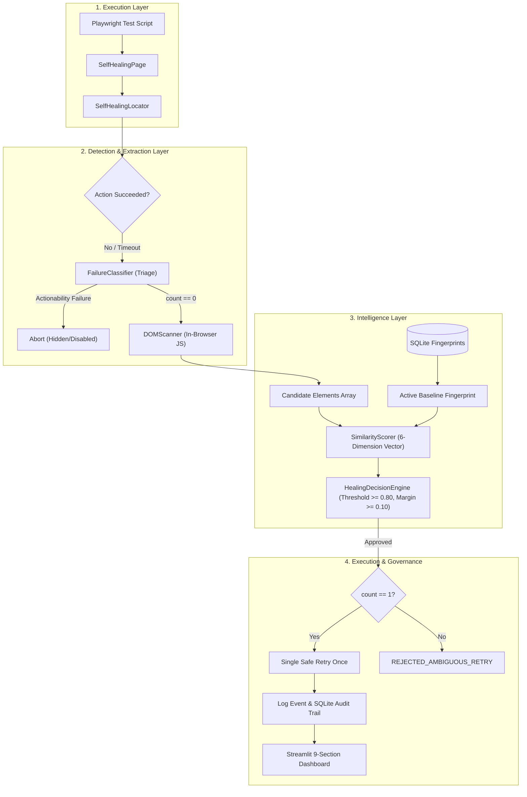

# SelfHeal Documentation Master Index & Technical Sitemap

**Moon Sanctum Labs** — *Decode. Build. Evolve.*  
**Lead Engineer:** Aniket Nandi (Kolkata, IST)  
**System Version:** `1.0.0`  
**License:** MIT License  

Welcome to the comprehensive technical documentation and academic research archive for the **SelfHeal — Intelligent Self-Healing UI Automation Framework for Microsoft Playwright**.

---

## 📚 Master Documentation Index

| Document | Primary Content & Focus | Key Deliverables & Highlights |
|---|---|---|
| **[1. Academic Technical Report](academic_report.md)** | Formal 10-Chapter Academic Research Paper | Abstract, Literature Review, Methodology, Empirical Evaluation, Formal Bibliography (IEEE/ACM style). |
| **[2. Architecture Diagrams Collection](architecture_diagrams.md)** | 12 Complete System & Dataflow Diagrams | C4 Context, High-Level Architecture, Component Diagram, DFD Levels 0/1/2, ERD, Use Case, Happy Path Sequence, Guardrail Sequence, WAL Concurrency, CI/CD Workflow. |
| **[3. Mathematical Formulation](mathematical_formulation.md)** | Similarity Engine & Vector Space Foundations | RapidFuzz formulas (Levenshtein, Jaro-Winkler, Token Sort), UI Synonyms, ARIA blending, Jaccard attributes, Parent/Child/Spatial proximity, worked example (Scenario B), calibration critique. |
| **[4. SQLite Database Schema & Architecture](database_schema.md)** | Embedded WAL Persistence & Versioning | Schema DDL (`schema.sql`), 5 tables, foreign key cascades, baseline lifecycle state machine (v1 $\rightarrow$ v2), concurrency isolation, privacy redaction. |
| **[5. Module Reference & API Specification](module_reference.md)** | Complete Source Code Technical Reference | Specifications for all 12 modules across Engine, Detection, Scanner, Intelligence, Persistence, Dashboard, Reporting, and CLI. |
| **[6. Experimental Evaluation & Profiling](experimental_evaluation.md)** | 109 Scenarios & 500+ Iterations Telemetry | Confusion matrices (Dataset 1, Holdout 2, Combined), 100% Precision, 0% FPR, 88.89% Recall, multi-tier latency percentiles, timeout dominance breakdown. |
| **[7. Requirements Traceability Matrix](traceability_matrix.md)** | Master Verification Matrix | Full mapping: Project Objective $\rightarrow$ Requirement $\rightarrow$ Module $\rightarrow$ Test Case $\rightarrow$ Metric $\rightarrow$ Evidence Artifact. |
| **[8. Technical Viva Defense Guide](viva_preparation.md)** | 30 Viva Questions & Detailed Answers | 20 foundational questions on Playwright, DOM, RapidFuzz, ARIA, and WAL + 10 challenging trade-off questions addressing architectural alternatives and limitations. |
| **[9. Demonstration Presentation Script](demo_presentation_script.md)** | 5–7 Minute Defense Presentation Script | Timed cues, talking points, live terminal commands, browser actions, and dashboard walkthrough guide. |
| **[10. Release Readiness Report](release_readiness_report.md)** | Engineering Reliability Audit & Release Verdict | Final release audit, test verification, security & privacy analysis, packaging checks, release blockers, and readiness recommendation. |
| **[11. Release Notes (v1.0.0)](release_1.0.0.md)** | Official Stable 1.0.0 Release Notes | Product overview, capabilities, canonical benchmarks, installation, quickstart, and known platform limitations. |

---

## 🏛️ System Architecture Summary

SelfHeal eliminates locator brittleness in automated web tests without monkey-patching or cloud LLMs.



---

## ⚡ Key Verified Performance & Accuracy Metrics

| Metric Category | Observed Verified Value | Verification Method |
|---|---|---|
| **Healing Precision** | **100.00%** (0 false positive interactions) | 109 Scenarios (`benchmark.py` & `holdout_benchmark.py`) |
| **False Positive Rate** | **0.00%** | 109 Scenarios |
| **Healing Recall** | **88.89%** (56/63 eligible repairs) | 109 Scenarios |
| **Overall Accuracy** | **93.58%** (102/109 scenarios) | 109 Scenarios |
| **Automated Unit Tests** | **30 / 30 Passing** (100%) | `pytest tests/ -v` |
| **Pure Algorithm Scoring** | **0.690 ms** (P50: 0.608 ms, P95: 1.127 ms) | 500+ Iterations (`profile_performance.py`) |
| **Decision Engine Gating** | **0.005 ms** (P50: 0.004 ms) | 500+ Iterations |
| **In-Browser DOM Extraction** | **2.303 ms** (P50: 2.177 ms) | 500+ Iterations |
| **Normal Execution Overhead**| **23.716 ms** (P50: 23.339 ms) | 500+ Iterations |
| **Standard Complete Healing**| **3,072.27 ms** ($2,500$ ms timeout) | 500+ Iterations |
| **Fast Complete Healing** | **1,572.06 ms** ($1,000$ ms timeout, 48.8% faster) | 500+ Iterations |

---

## 🛠️ Verification & Reproduction Quickstart

To reproduce the test suite, benchmarks, and dashboard locally:

```bash
# 1. Run all 30 automated test cases
python -m pytest tests/ -v

# 2. Run the 12-step academic demonstration
python scripts/run_academic_demo.py

# 3. Launch the 9-section Streamlit engineering dashboard
streamlit run src/selfheal/dashboard/app.py

# 4. Run the 500+ iteration performance profiler
python tests/evaluation/profile_performance.py
```

