# System Architecture Diagrams & Formal Specifications

**Moon Sanctum Labs** — *Decode. Build. Evolve.*  
**Lead Engineer:** Aniket Nandi (Kolkata, IST)  
**Project:** SelfHeal — Intelligent Self-Healing UI Automation Framework  
**Version:** `1.0.0rc1`  
**Target Platform:** Python 3.11+ / Microsoft Playwright / SQLite WAL Mode  

---

## Table of Diagrams

1. [System Context Diagram (C4 Level 1)](#1-system-context-diagram-c4-level-1)
2. [High-Level System Architecture](#2-high-level-system-architecture)
3. [Component Architecture Diagram](#3-component-architecture-diagram)
4. [Data Flow Diagram — Level 0 (Context Level)](#4-data-flow-diagram--level-0-context-level)
5. [Data Flow Diagram — Level 1 (Subsystem Level)](#5-data-flow-diagram--level-1-subsystem-level)
6. [Data Flow Diagram — Level 2 (Intelligence & Decision Engine)](#6-data-flow-diagram--level-2-intelligence--decision-engine)
7. [Entity Relationship Diagram (ERD)](#7-entity-relationship-diagram-erd)
8. [System Use Case Diagram](#8-system-use-case-diagram)
9. [Successful Healing Sequence Diagram (Happy Path)](#9-successful-healing-sequence-diagram-happy-path)
10. [Rejected Healing Sequence Diagram (Safety Guardrails)](#10-rejected-healing-sequence-diagram-safety-guardrails)
11. [Database & Concurrency Architecture (WAL Mode)](#11-database--concurrency-architecture-wal-mode)
12. [CI/CD Deployment & Packaging Workflow](#12-cicd-deployment--packaging-workflow)

---

## 1. System Context Diagram (C4 Level 1)

The System Context diagram describes the boundary of the SelfHeal framework, its users, and external integrations in an automated test environment.

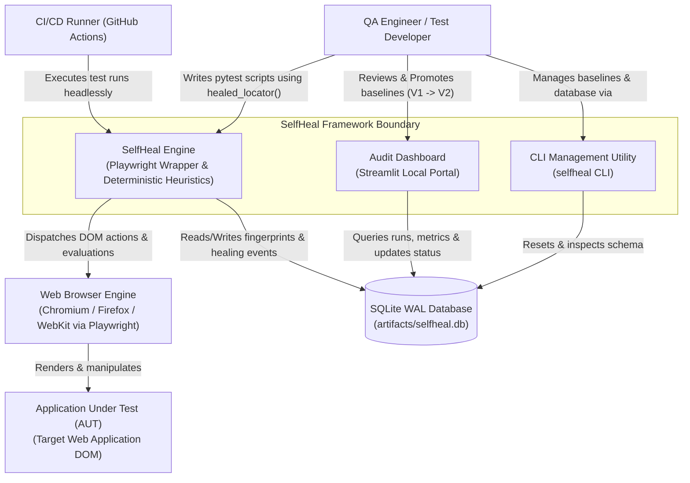

---

## 2. High-Level System Architecture

A multi-tiered architectural overview illustrating the five operational layers: Test Execution, Failure Detection, Intelligence & Decision, Storage, and Presentation/Audit.

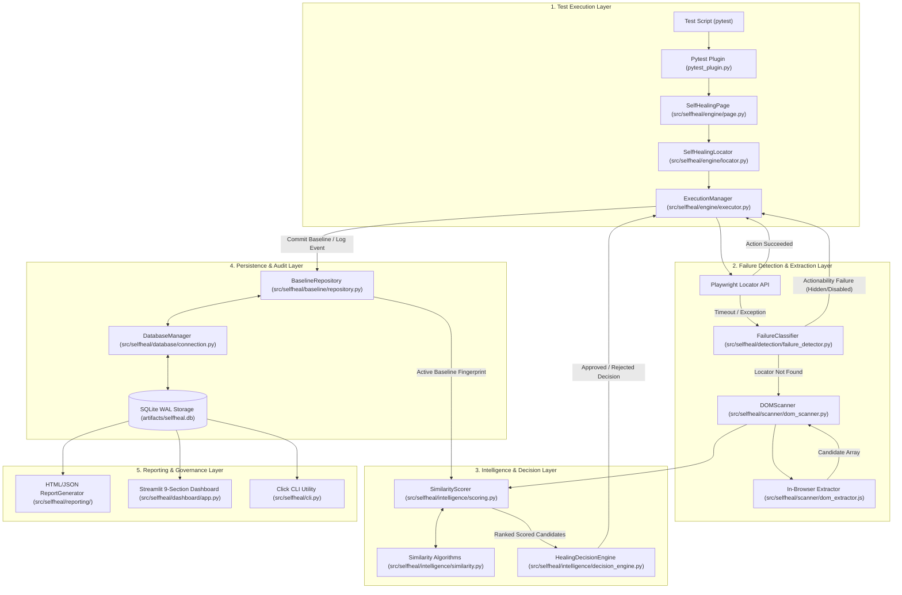

---

## 3. Component Architecture Diagram

Detailed component interface boundaries showing classes, dependencies, and invocation contracts.

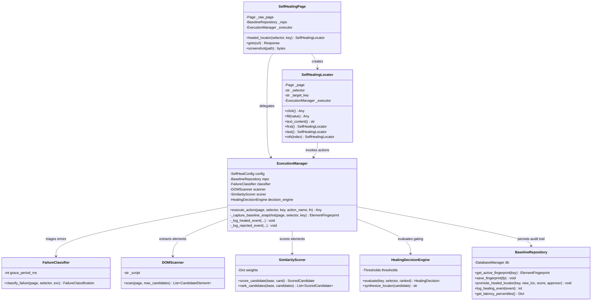

---

## 4. Data Flow Diagram — Level 0 (Context Level)

Level 0 DFD illustrates external data flowing into and out of the SelfHeal framework environment.

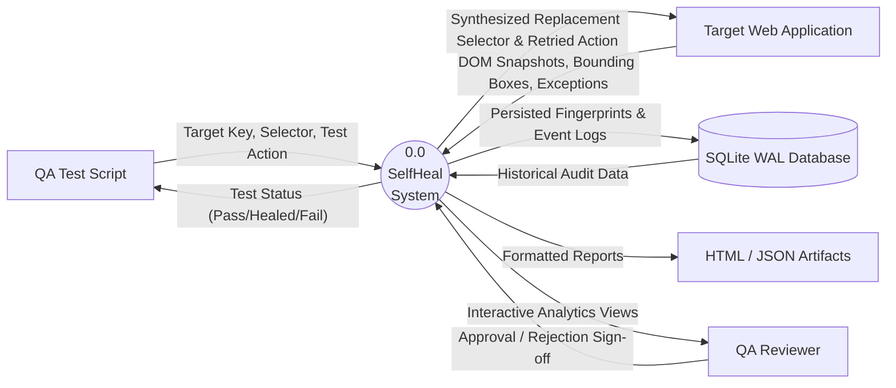

---

## 5. Data Flow Diagram — Level 1 (Subsystem Level)

Level 1 DFD shows the flow of data through major subsystem processes during test execution.

```mermaid
flowchart TD
    Script["Test Script"]
    P1["1.0 Action Interception & Baseline Snapshot"]
    P2["2.0 Failure Classification & Triage"]
    P3["3.0 DOM Candidate Extraction"]
    P4["4.0 Multi-Dimensional Similarity Scoring"]
    P5["5.0 Confidence & Margin Decision Gating"]
    P6["6.0 Candidate Uniqueness Verification & Retry"]
    P7["7.0 Audit Trail & Baseline Evolution"]
    
    D1[("element_fingerprints")]
    D2[("healing_events")]
    D3[("locator_history")]
    D4[("test_runs")]

    Script -->|"healed_locator.click()"| P1
    P1 -->|"Pre-execution Fingerprint"| D1
    P1 -- "Action Throws Timeout/Exception" --> P2
    
    P2 -- "Loc Count == 0 (Eligible)" --> P3
    P2 -- "Hidden/Disabled/Syntax Error" -->|"UnhealableFailureError"| Script
    
    P3 -->|"Array of Candidate Elements"| P4
    D1 -->|"Active Baseline Fingerprint"| P4
    
    P4 -->|"Ranked Candidates + Score Breakdown"| P5
    P5 -- "Score < 0.80 or Margin < 0.10" -->|"HealingConfidenceError"| P7
    P5 -- "Approved Candidate" --> P6
    
    P6 -- "Count == 1 (Unique) -> Retry OK" --> P7
    P6 -- "Count != 1 (Ambiguous) -> Reject" --> P7
    
    P7 -->|"Log Healing Record"| D2
    P7 -->|"Update Test Summary"| D4
    P7 -->|"Promote New Selector (if Automatic)"| D3
    P7 -->|"Return Execution Result"| Script
```

---

## 6. Data Flow Diagram — Level 2 (Intelligence & Decision Engine)

Level 2 DFD details the internal mathematical score generation and decision tree.

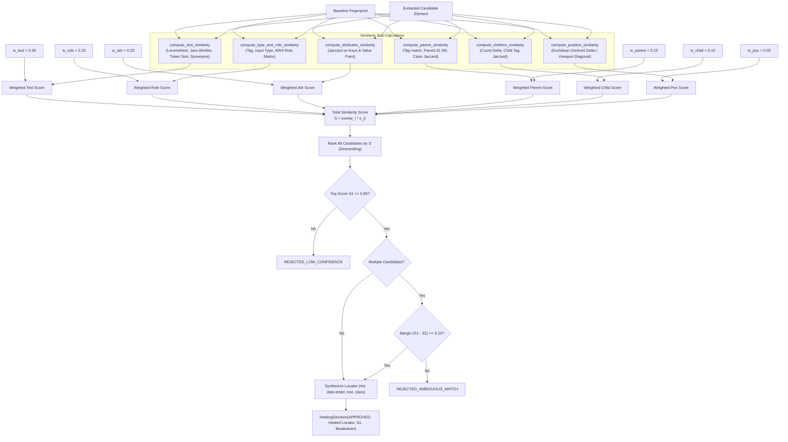

---

## 7. Entity Relationship Diagram (ERD)

Derived directly from `src/selfheal/database/schema.sql`.

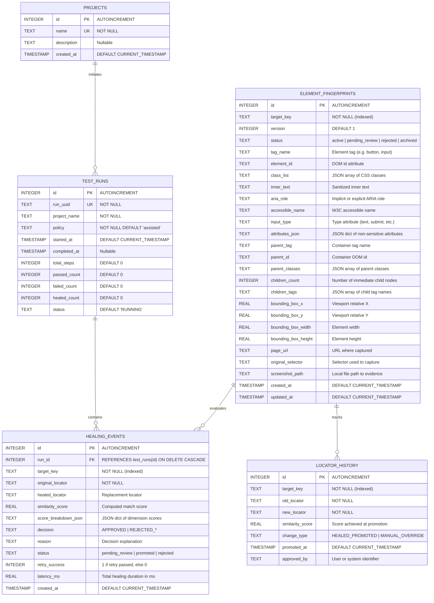

---

## 8. System Use Case Diagram

Identifies user roles, system boundaries, and primary interactions.

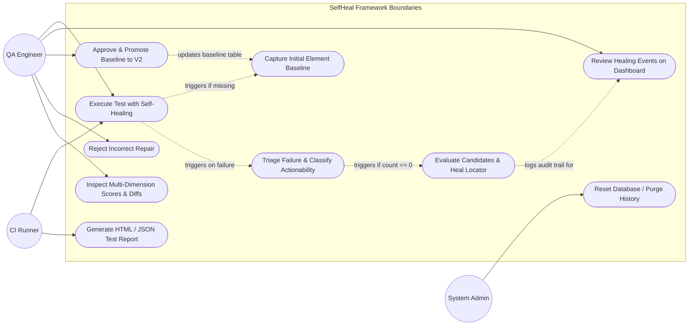

---

## 9. Successful Healing Sequence Diagram (Happy Path)

Trace of Scenario B: Original `#btnLogin` mutated to `#btnSignInSubmit`.

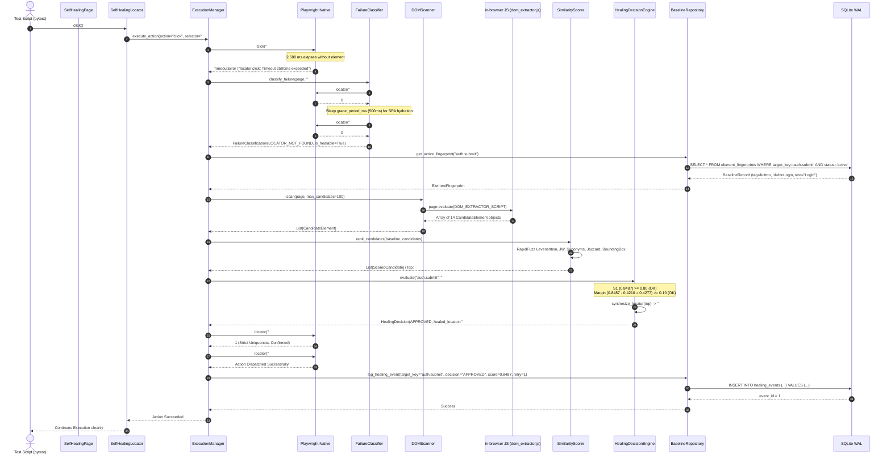

---

## 10. Rejected Healing Sequence Diagram (Safety Guardrails)

Trace showing the two mandatory safety guardrails: Actionability Failure and Ambiguous Match Rejection.

```mermaid
sequenceDiagram
    autonumber
    actor Script as Test Script
    participant Exec as ExecutionManager
    participant PW as Playwright Native
    participant Class as FailureClassifier
    participant Scanner as DOMScanner
    participant Scorer as SimilarityScorer
    participant Dec as HealingDecisionEngine
    participant Repo as BaselineRepository

    rect rgb(30, 20, 20)
        Note over Script,Repo: SCENARIO 1: ACTIONABILITY REJECTION (Element Disabled / Hidden)
        Script->>Exec: execute_action("#btnDisabled", "checkout.express")
        Exec->>PW: click("#btnDisabled", timeout=2500ms)
        PW-->>Exec: TimeoutError ("element is disabled - waiting for element to be enabled...")
        Exec->>Class: classify_failure("#btnDisabled")
        Class->>PW: locator("#btnDisabled").count()
        PW-->>Class: 1
        Class->>PW: locator("#btnDisabled").first.is_enabled()
        PW-->>Class: False
        Class-->>Exec: FailureClassification(ELEMENT_DISABLED, is_healable=False)
        Exec->>Repo: log_rejected_event(decision="REJECTED_ACTIONABILITY")
        Exec-->>Script: raise UnhealableFailureError ("ELEMENT_DISABLED")
    end

    rect rgb(20, 25, 30)
        Note over Script,Repo: SCENARIO 2: AMBIGUITY REJECTION (Confidence Margin < 0.10)
        Script->>Exec: execute_action("#payOption", "pay.method")
        Exec->>PW: click("#payOption", timeout=2500ms)
        PW-->>Exec: TimeoutError
        Exec->>Class: classify_failure("#payOption")
        Class-->>Exec: FailureClassification(LOCATOR_NOT_FOUND, is_healable=True)
        Exec->>Scanner: scan(page)
        Scanner-->>Exec: Candidates (#payOption1, #payOption2)
        Exec->>Scorer: rank_candidates(baseline, candidates)
        Scorer-->>Exec: Ranked: S1 = 0.8769 (#payOption1), S2 = 0.8720 (#payOption2)
        Exec->>Dec: evaluate("pay.method", "#payOption", ranked)
        Note over Dec: S1 (0.8769) >= 0.80 (Passes Threshold)<br/>Margin: 0.8769 - 0.8720 = 0.0049 < 0.10 (FAILS MARGIN!)
        Dec-->>Exec: HealingDecision(REJECTED_AMBIGUOUS_MATCH, margin=0.0049)
        Exec->>Repo: log_rejected_event(decision="REJECTED_AMBIGUOUS_MATCH")
        Exec-->>Script: raise HealingConfidenceError ("Ambiguous match: margin 0.0049 < 0.10")
    end
```

---

## 11. Database & Concurrency Architecture (WAL Mode)

Illustrates how SQLite Write-Ahead Logging (WAL) facilitates concurrent non-blocking reads from the Streamlit Dashboard and test runs while ensuring atomic writes.

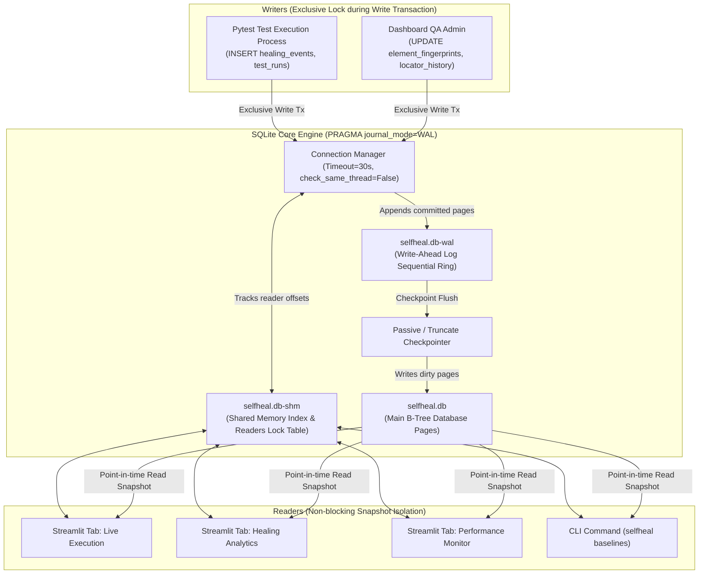

---

## 12. CI/CD Deployment & Packaging Workflow

Maps the automated testing, verification, packaging, and artifact publishing defined in `.github/workflows/ci.yml`.

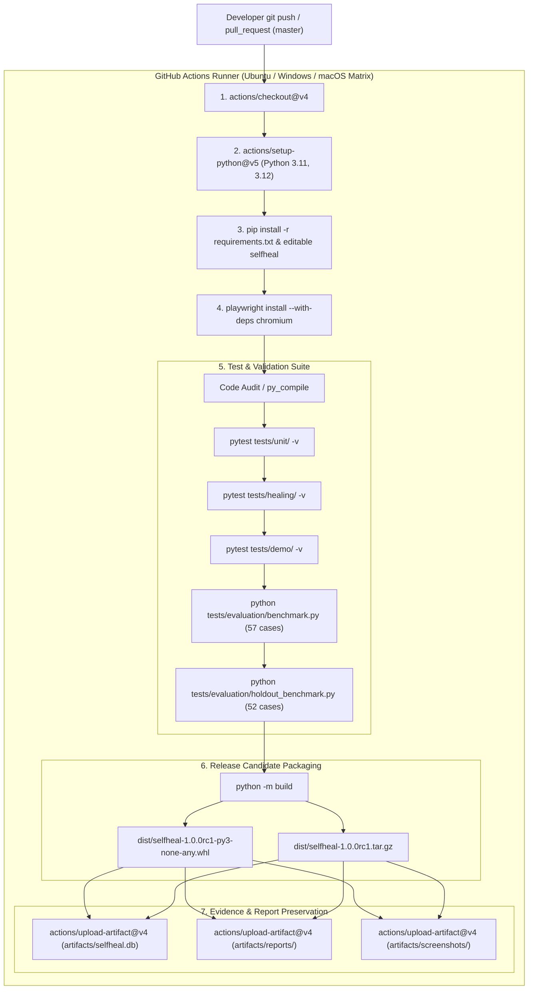

