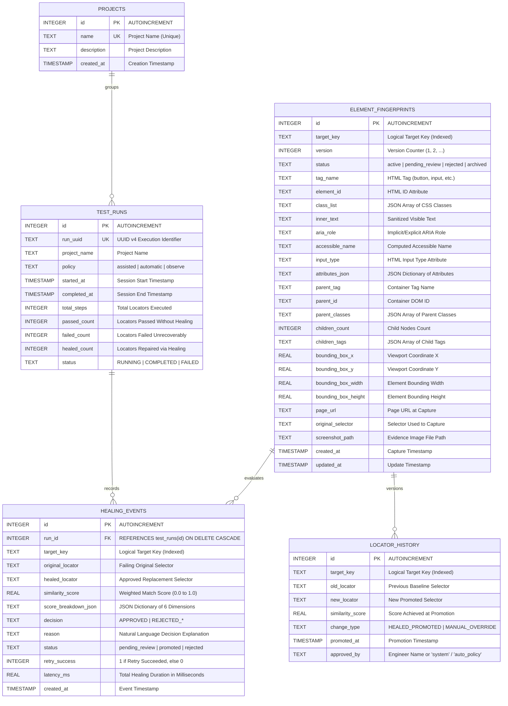

# SQLite Database Schema & Persistence Architecture

**Moon Sanctum Labs** — *Decode. Build. Evolve.*  
**Lead Engineer:** Aniket Nandi (Kolkata, IST)  
**System Version:** `1.0.0rc1`  
**Storage Engine:** SQLite 3.37+ in WAL Mode (`artifacts/selfheal.db`)  
**DDL Source:** `src/selfheal/database/schema.sql`  

---

## 1. Persistence Layer Architecture

The SelfHeal framework uses an embedded SQLite database configured in Write-Ahead Logging (`WAL`) mode. This provides atomic, isolated, and durable (ACID) persistence for baseline DOM fingerprints, execution telemetry, and audit history.

### Key Database Properties
1. **Zero External Daemon Dependencies:** Embedded SQLite database running in-process; no Docker containers, remote network sockets, or external database credentials required.
2. **Concurrent Multi-Process Access:** Configured with `PRAGMA journal_mode=WAL;` and `PRAGMA busy_timeout=30000;`. Writers (e.g. running pytest test suites) do not block readers (e.g. the Streamlit audit dashboard), enabling real-time telemetry inspection during active test runs.
3. **Structured Foreign Key Cascades:** `PRAGMA foreign_keys = ON;` enforces relational integrity between test runs and recorded healing events.

---

## 2. Entity Relationship Diagram (ERD)



---

## 3. Detailed Table Specifications

### 3.1 Table: `projects`
Stores high-level test automation suites or application workspaces.

| Column | Type | Constraints | Description |
|---|---|---|---|
| `id` | `INTEGER` | `PRIMARY KEY AUTOINCREMENT` | Internal synthetic identifier |
| `name` | `TEXT` | `NOT NULL UNIQUE` | Unique project namespace identifier |
| `description` | `TEXT` | `NULL` | Optional project metadata description |
| `created_at` | `TIMESTAMP` | `DEFAULT CURRENT_TIMESTAMP` | Project record creation timestamp |

---

### 3.2 Table: `test_runs`
Records test session execution batches, policy configurations, and aggregate telemetry.

| Column | Type | Constraints | Description |
|---|---|---|---|
| `id` | `INTEGER` | `PRIMARY KEY AUTOINCREMENT` | Internal run identifier |
| `run_uuid` | `TEXT` | `NOT NULL UNIQUE` | UUID v4 generated at session start |
| `project_name` | `TEXT` | `NOT NULL` | Associated project name |
| `policy` | `TEXT` | `NOT NULL DEFAULT 'assisted'` | Active policy: `assisted`, `automatic`, `observe` |
| `started_at` | `TIMESTAMP` | `DEFAULT CURRENT_TIMESTAMP` | Session start time |
| `completed_at` | `TIMESTAMP` | `NULL` | Session termination time |
| `total_steps` | `INTEGER` | `DEFAULT 0` | Total number of element interactions attempted |
| `passed_count` | `INTEGER` | `DEFAULT 0` | Total interactions passed without healing |
| `failed_count` | `INTEGER` | `DEFAULT 0` | Total interactions failed unrecoverably |
| `healed_count` | `INTEGER` | `DEFAULT 0` | Total interactions recovered through healing |
| `status` | `TEXT` | `DEFAULT 'RUNNING'` | Lifecycle state: `RUNNING`, `COMPLETED`, `FAILED` |

---

### 3.3 Table: `element_fingerprints`
Stores multi-dimensional structural snapshots of target elements used as baselines for comparison.

| Column | Type | Constraints | Description |
|---|---|---|---|
| `id` | `INTEGER` | `PRIMARY KEY AUTOINCREMENT` | Fingerprint record identifier |
| `target_key` | `TEXT` | `NOT NULL` | Stable logical key (e.g. `auth.submit_button`) |
| `version` | `INTEGER` | `DEFAULT 1` | Incremental baseline version counter |
| `status` | `TEXT` | `DEFAULT 'active'` | State: `active`, `pending_review`, `rejected`, `archived` |
| `tag_name` | `TEXT` | `NULL` | HTML tag name (e.g. `button`, `input`, `a`) |
| `element_id` | `TEXT` | `NULL` | DOM `id` attribute (sanitized) |
| `class_list` | `TEXT` | `NULL` | JSON array of CSS class names |
| `inner_text` | `TEXT` | `NULL` | Sanitized visible inner text |
| `aria_role` | `TEXT` | `NULL` | W3C ARIA role attribute or implicit role |
| `accessible_name` | `TEXT` | `NULL` | Computed accessible name |
| `input_type` | `TEXT` | `NULL` | HTML `type` attribute for `<input>` elements |
| `attributes_json` | `TEXT` | `NULL` | JSON dictionary of non-sensitive attributes |
| `parent_tag` | `TEXT` | `NULL` | Container parent HTML tag |
| `parent_id` | `TEXT` | `NULL` | Container parent DOM `id` |
| `parent_classes` | `TEXT` | `NULL` | JSON array of parent CSS classes |
| `children_count` | `INTEGER` | `DEFAULT 0` | Count of immediate children elements |
| `children_tags` | `TEXT` | `NULL` | JSON array of immediate child tag names |
| `bounding_box_x` | `REAL` | `NULL` | Centroid or top-left viewport X coordinate |
| `bounding_box_y` | `REAL` | `NULL` | Centroid or top-left viewport Y coordinate |
| `bounding_box_width` | `REAL` | `NULL` | Bounding box width in CSS pixels |
| `bounding_box_height`| `REAL` | `NULL` | Bounding box height in CSS pixels |
| `page_url` | `TEXT` | `NULL` | URL of page where element was captured |
| `original_selector` | `TEXT` | `NULL` | CSS/XPath selector originally used to locate |
| `screenshot_path` | `TEXT` | `NULL` | Relative file path to visual evidence artifact |
| `created_at` | `TIMESTAMP` | `DEFAULT CURRENT_TIMESTAMP` | Initial capture timestamp |
| `updated_at` | `TIMESTAMP` | `DEFAULT CURRENT_TIMESTAMP` | Record modification timestamp |

#### Composite Index:
```sql
CREATE INDEX IF NOT EXISTS idx_fingerprint_key_status 
ON element_fingerprints(target_key, status);
```

---

### 3.4 Table: `healing_events`
Audit trail recording every intercepted failure, candidate scores, decision outcome, and execution latency.

| Column | Type | Constraints | Description |
|---|---|---|---|
| `id` | `INTEGER` | `PRIMARY KEY AUTOINCREMENT` | Unique healing event identifier |
| `run_id` | `INTEGER` | `FOREIGN KEY REFERENCES test_runs(id) ON DELETE CASCADE` | Associated test run |
| `target_key` | `TEXT` | `NOT NULL` | Associated logical key |
| `original_locator` | `TEXT` | `NOT NULL` | Failing locator that triggered healing |
| `healed_locator` | `TEXT` | `NULL` | Replacement locator synthesized by engine |
| `similarity_score` | `REAL` | `NULL` | Winning candidate similarity score ($S_1$) |
| `score_breakdown_json`| `TEXT` | `NULL` | JSON dictionary containing all 6 dimension scores |
| `decision` | `TEXT` | `NOT NULL` | Outcome: `APPROVED`, `REJECTED_LOW_CONFIDENCE`, `REJECTED_AMBIGUOUS_MATCH`, `REJECTED_ACTIONABILITY` |
| `reason` | `TEXT` | `NULL` | Natural language explanation of decision |
| `status` | `TEXT` | `DEFAULT 'pending_review'` | Review status: `pending_review`, `promoted`, `rejected` |
| `retry_success` | `INTEGER` | `DEFAULT 0` | Boolean indicator (1 = passed, 0 = failed) |
| `latency_ms` | `REAL` | `DEFAULT 0.0` | Total healing interception latency in ms |
| `created_at` | `TIMESTAMP` | `DEFAULT CURRENT_TIMESTAMP` | Event timestamp |

#### Indexes:
```sql
CREATE INDEX IF NOT EXISTS idx_healing_run_id ON healing_events(run_id);
CREATE INDEX IF NOT EXISTS idx_healing_target_key ON healing_events(target_key);
```

---

### 3.5 Table: `locator_history`
Maintains permanent audit log of all selector mutations and baseline promotions.

| Column | Type | Constraints | Description |
|---|---|---|---|
| `id` | `INTEGER` | `PRIMARY KEY AUTOINCREMENT` | History record identifier |
| `target_key` | `TEXT` | `NOT NULL` | Target logical key |
| `old_locator` | `TEXT` | `NOT NULL` | Previous locator string |
| `new_locator` | `TEXT` | `NOT NULL` | Newly promoted replacement locator |
| `similarity_score` | `REAL` | `NULL` | Similarity score achieved at promotion |
| `change_type` | `TEXT` | `DEFAULT 'HEALED_PROMOTED'` | Cause: `HEALED_PROMOTED`, `MANUAL_OVERRIDE` |
| `promoted_at` | `TIMESTAMP` | `DEFAULT CURRENT_TIMESTAMP` | Timestamp when change was approved |
| `approved_by` | `TEXT` | `DEFAULT 'system'` | Sign-off entity (`system`, `auto_policy`, or QA user) |

#### Index:
```sql
CREATE INDEX IF NOT EXISTS idx_history_key ON locator_history(target_key);
```

---

## 4. Baseline Versioning Lifecycle

Baseline fingerprints transition through a controlled state machine:

```mermaid
stateDiagram-v2
    [*] --> active : Baseline Captured (V1)
    
    active --> pending_review : Healing Succeeded (Assisted Policy)
    active --> active_v2 : Healing Succeeded (Automatic Policy)
    
    pending_review --> active_v2 : Approved in Audit Centre (Promote to V2)
    pending_review --> rejected : Rejected in Audit Centre
    
    active_v2 --> archived : Superseded by V3
    rejected --> [*]
    archived --> [*]

    state active_v2 {
        [*] --> ActiveV2Ready
        note right of ActiveV2Ready: Previous V1 marked 'archived'; V2 becomes 'active'
    }
```



### Baseline Promotion Logic (`BaselineRepository.promote_healed_locator`):
When a healed locator is promoted:
1. The currently `active` fingerprint for `target_key` is marked `archived`.
2. A new fingerprint row is inserted with `version = old_version + 1` and `status = 'active'`, containing the updated selector and attributes.
3. An audit row is inserted into `locator_history` recording `old_locator`, `new_locator`, `similarity_score`, and `approved_by`.
4. The corresponding row in `healing_events` is updated to `status = 'promoted'`.

---

## 5. Security & Privacy Safeguards

The framework implements strict local privacy controls:
1. **Password Redaction:** During fingerprint extraction (`extract_fingerprint` in `src/selfheal/baseline/fingerprint.py`), if an `<input>` has `type="password"`, its `inner_text`, `value`, and `placeholder` are sanitized to empty strings before writing to SQLite.
2. **Parameterized Queries:** All SQL statements in `src/selfheal/baseline/repository.py` use SQLite parameterized placeholders (`?`). String interpolation is prohibited, eliminating SQL injection risks.
3. **Local-First Architecture:** No DOM snapshots, attributes, or telemetry data are ever transmitted to third-party endpoints or external cloud APIs.

