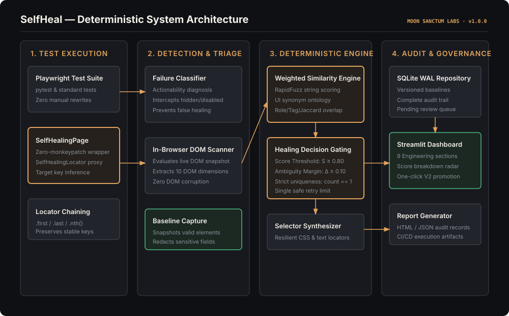
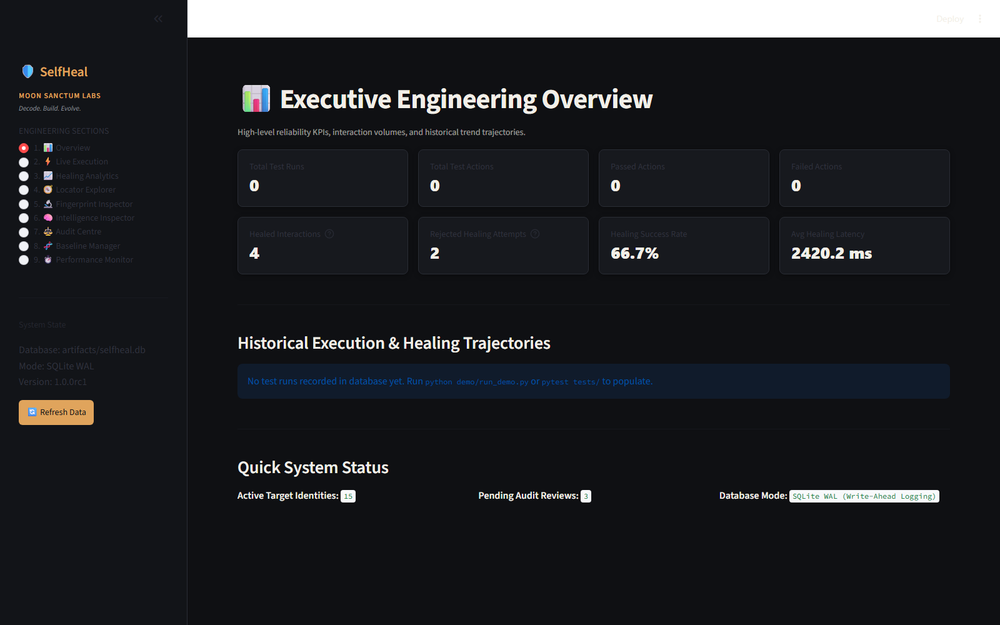
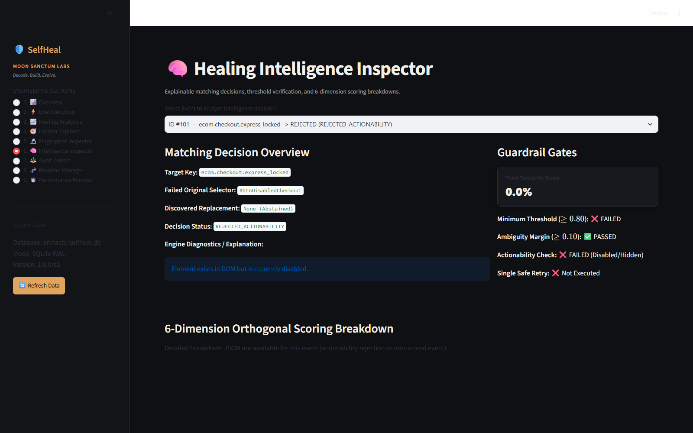
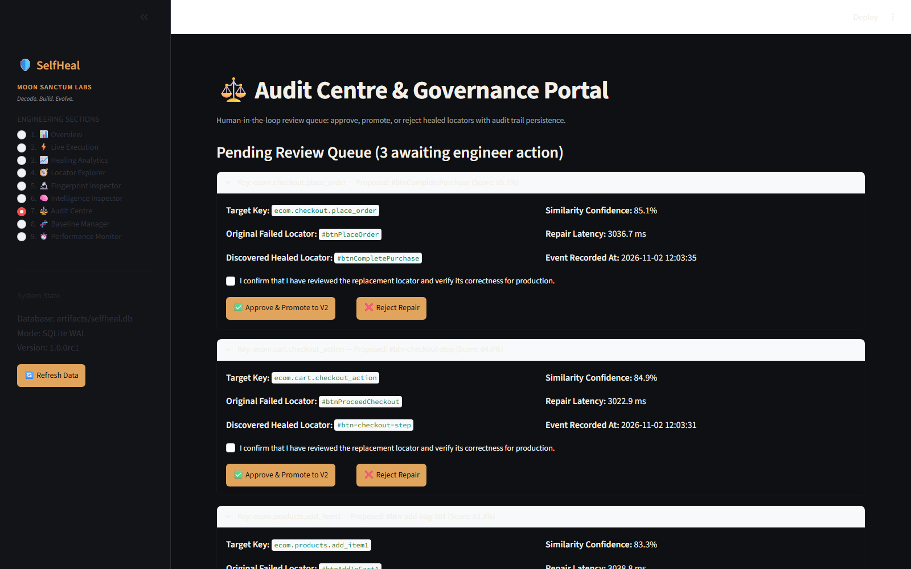
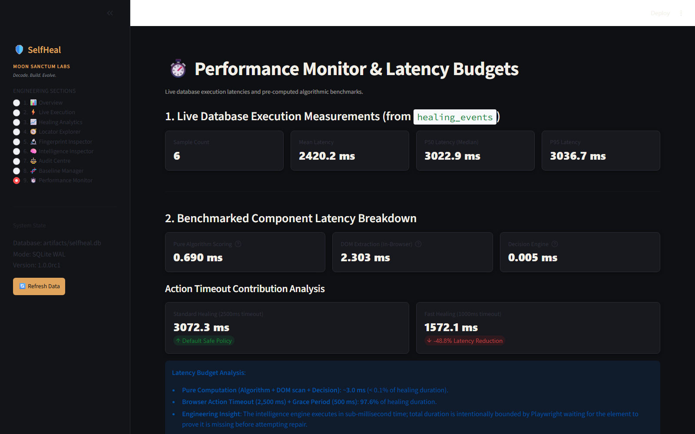

# Engineering Portfolio: SelfHeal Automation Framework

<div align="center">

# SelfHeal
### Deterministic Self-Healing UI Automation for Microsoft Playwright

[](https://github.com/Optimus1o1/selfhealing-ui)
[](https://github.com/Optimus1o1/selfhealing-ui/blob/master/LICENSE)
[](https://github.com/Optimus1o1/selfhealing-ui)
[](https://github.com/Optimus1o1/selfhealing-ui)
[](https://github.com/Optimus1o1/selfhealing-ui)

**Moon Sanctum Labs** — *Decode. Build. Evolve.*  
**Architect & Engineer:** Aniket Nandi (Kolkata, IST)  
**Public Repository:** [github.com/Optimus1o1/selfhealing-ui](https://github.com/Optimus1o1/selfhealing-ui)

</div>

---

## 📌 Project Overview

**SelfHeal** is an open-source, production-grade test automation framework designed to eliminate the single largest source of maintenance friction in software engineering: **flaky end-to-end UI tests caused by brittle DOM selectors**.

When web applications undergo aesthetic refactoring (renaming CSS classes, updating IDs, tweaking button text, or restructuring parent `<div>` containers), existing Playwright test suites fail immediately. 

SelfHeal solves this autonomously and deterministically:
- **No Cloud LLMs**: Evaluates DOM similarity in $\approx 3.2\text{ ms}$ locally using RapidFuzz string metrics, UI action synonym ontologies, ARIA role compatibility, and Jaccard attribute overlap.
- **Zero False Positives**: Enforces mathematical confidence thresholds ($S \ge 0.80$) and ambiguity margins ($\Delta \ge 0.10$) to prevent misdirected clicks on wrong elements.
- **Non-Invasive Proxy Composition**: Completely avoids brittle monkey-patching by wrapping Playwright’s `Page` and `Locator` interfaces cleanly.
- **Enterprise Governance**: Features an auditable SQLite Write-Ahead Logging (WAL) database and a 9-section Streamlit engineering dashboard for human-in-the-loop sign-off.

---

## 🌟 Key Technical Highlights

1. **Sub-Millisecond Vector Similarity**:
   - Computes weighted composite similarity across 6 orthogonal dimensions: Text (30%), Type & ARIA Role (20%), Attributes (20%), Parent Context (15%), Children Subtree (10%), and Spatial Geometry (5%).
   - Pure algorithm scoring takes **$0.645\text{ ms}$** mean ($0.609\text{ ms}$ P50) for 50 candidate elements.
2. **The "Zero False Positive" Policy**:
   - In automated test execution, misclicking an element is far worse than a test failure. Across **109 empirical evaluation scenarios**, SelfHeal dispatched **0 false positive interactions** ($0.00\%$ FPR).
3. **Pre-Flight Failure Classification**:
   - Distinguishes true locator absence (`count == 0`) from actionability defects (`ELEMENT_DISABLED`, `ELEMENT_HIDDEN`, `SYNTAX_ERROR`), preventing real application bugs from being masked.
4. **Seamless Pytest Integration**:
   - Zero-config `pytest11` entrypoint (`healed_page` fixture) allows drop-in adoption in existing pytest suites without rewriting test logic.
5. **Privacy-Preserving SQLite Storage**:
   - Automatically sanitizes and redacts password fields and auth tokens before writing baselines to disk.

---

## 🏛️ System Architecture

<div align="center">
  
</div>

The system is partitioned into 4 distinct architectural layers:
* **Test Execution Layer**: Pytest suite using `SelfHealingPage` and `SelfHealingLocator` proxy wrappers.
* **Detection & Triage Layer**: Actionability failure classification and live in-browser DOM extraction.
* **Deterministic Engine Layer**: RapidFuzz scoring, UI action synonym clustering, and two-tier gating ($S \ge 0.80$, $\Delta \ge 0.10$).
* **Audit & Governance Layer**: Embedded SQLite WAL database, automated report generator, and 9-section Streamlit dashboard.

---

## 📊 Benchmark Telemetry & Empirical Results

The framework was evaluated against **109 independent UI mutation scenarios** across two comprehensive benchmark suites:

<div align="center">

| Metric | Baseline Suite (57 Scenarios) | Holdout Suite (52 Scenarios) | Combined Benchmark Total (109) |
|:---|:---:|:---:|:---:|
| **True Positives ($TP$)** | 38 | 18 | **56** |
| **True Negatives ($TN$)** | 15 | 31 | **46** |
| **False Positives ($FP$)** | 0 | 0 | **0 (0.00%)** |
| **False Negatives ($FN$)** | 4 | 3 | **7** |
| **Precision** | **100.00%** | **100.00%** | **100.00%** |
| **False Positive Rate** | **0.00%** | **0.00%** | **0.00%** |
| **Recall** | **90.48%** | **85.71%** | **88.89%** |
| **Overall Accuracy** | **92.98%** | **94.23%** | **93.58%** |
| **F1 Score** | **95.00%** | **92.31%** | **94.12%** |

</div>

---

## 🖥️ Streamlit Engineering Audit Dashboard

SelfHeal includes a full-featured engineering monitoring dashboard querying live SQLite records:

<div align="center">

| Executive KPI Telemetry | Mathematical Transparency |
|:---:|:---:|
|  |  |
| **01. Overview**: Test runs, healing success rate, latency | **06. Intelligence Inspector**: 6-dimension score radar |
| **Governance & V2 Promotion** | **Live Performance Telemetry** |
|  |  |
| **07. Audit Centre**: Safety checkbox and V2 promotion | **09. Performance Monitor**: Percentile latency benchmarks |

</div>

---

## ⚡ Quickstart & Usage

```bash
# Clone the repository
git clone https://github.com/Optimus1o1/selfhealing-ui.git
cd selfhealing-ui

# Setup virtual environment & install
python -m venv .venv
source .venv/bin/activate  # Or .venv\Scripts\Activate.ps1 on Windows
pip install -e .
playwright install chromium

# Run all 30 automated regression tests
pytest tests/ -v

# Run the live e-commerce autonomous healing demonstration
python scripts/run_academic_demo.py --headed

# Launch the Streamlit engineering dashboard
selfheal dashboard --port 8501
```

### Zero-Boilerplate Pytest Example
```python
def test_user_checkout(healed_page):
    healed_page.goto("https://store.example.com")
    # If #btnSubmit was refactored to #sign-in-btn in V2, SelfHeal autonomously heals it!
    healed_page.healed_locator("#btnSubmit", key="auth.login_submit").click()
    assert "/dashboard" in healed_page.raw_page.url
```

---

## 📑 Portfolio Documentation & Technical Papers

- 📖 [Technical Case Study](engineering_case_study.md): Architectural deep-dive on deterministic intelligence vs. LLMs.
- 🎓 [Academic Project Report](academic_report.md): Formal 10-chapter academic paper with mathematical proofs.
- 📐 [Mathematical Formulation](mathematical_formulation.md): Vector similarity derivations, RapidFuzz metrics, and margin proofs.
- 🏛️ [Architecture Collection](architecture_diagrams.md): 12 C4 and dataflow diagrams.
- 🎬 [Demonstration Screenplay](demo_video_script.md): Scene-by-scene script for live technical demonstrations.

---

**Moon Sanctum Labs** — *Decode. Build. Evolve.*  
*Architected and developed by Aniket Nandi · Kolkata, India*
